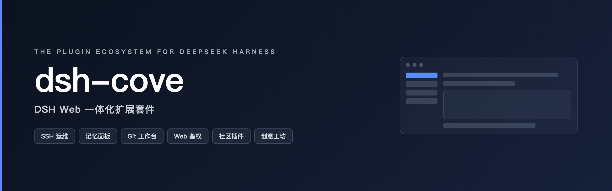
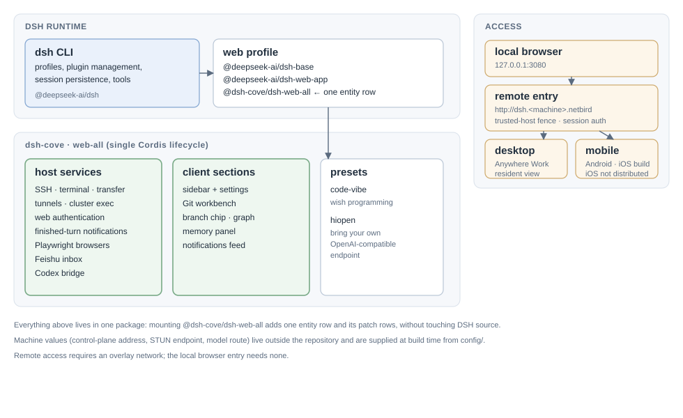

# dsh-cove · DeepSeek Harness（DSH）Web GUI 扩展套件

[English](README.md) | 中文

<p align="center">
  
</p>

<p align="center">
  <a href="https://github.com/chengxiang-zhang/dsh-cove/actions/workflows/ci.yml"></a>
  &nbsp;
  
  &nbsp;
  
  &nbsp;
  <a href="https://www.npmjs.com/package/@dsh-cove/dsh-web-all"></a>
  &nbsp;
  
  &nbsp;
  
</p>

<p align="center">
  <strong>DeepSeek Harness（DSH）Web GUI 的一体化扩展套件</strong><br>
  <em>SSH 运维 · 记忆面板 · Git 工作台 · 浏览器自动化 · 飞书接入 · 运行结束通知</em>
</p>

<div align="center">

[是什么](#是什么) · [架构](#架构) · [功能](#功能) · [快速上手](#快速上手) · [文档](#文档) · [安全](#安全) · [社区](#社区与支持) · [贡献](#参与贡献)

</div>

## 是什么

dsh-cove 是 DeepSeek Harness（DSH）Web GUI 的一体化扩展套件：SSH 运维、记忆面板、Git 工作台、飞书接入、运行结束通知与浏览器自动化等能力统一收进一个运行时实体插件 `@dsh-cove/dsh-web-all`。浏览器代码按 DSH 注入位置组织，同一位置只有一个模块负责注册与编排；host 能力是同一插件生命周期下的服务域。Profile 只挂载这一个包，不修改 DSH 源码。社区插件登记在仓库索引中，保留在各自作者自己的仓库里。

项目处于开发者预览阶段：接口、配置键与内部契约可能随版本变化，见[版本与发布](#版本与发布)。

## 架构



- **DSH 运行时**：`dsh` CLI 管理 profile、插件、会话持久化与工具；web profile 由 `@deepseek-ai/dsh-base`、`@deepseek-ai/dsh-web-app` 与本仓库的 `@dsh-cove/dsh-web-all` 组成。
- **单一实体**：`dsh-web-all` 只向 profile 贡献一行 `web-all`，host 服务与浏览器区块同属这一条 Cordis 生命周期。
- **接入方式**：本机浏览器直连 `127.0.0.1:3080`；远程入口需要 overlay 网络与 `--trusted-host` 围栏；桌面端与移动端是同一份 Web UI 的常驻壳。
- **机器相关值**：控制面地址、STUN 端点与模型路由都不进仓库，由 `config/` 在构建期注入。

## 功能

### SSH 远程连接

侧边栏「SSH」入口打开远程运维面板。主机支持密钥 / 密码认证，可从 `~/.ssh/config` 一键导入；配置都在 `~/.dsh/dsh-ssh.json`。对已配置主机可执行真实操作：

- **Web 终端**：xterm.js 远程终端，实时输出，窗口大小自适应；
- **文件传输**：SFTP 上传 / 下载，有进度条，可浏览远程目录；
- **端口转发**：本地隧道直连远程内网服务（数据库、API、管理后台），只监听 `127.0.0.1`；
- **集群执行**：一条命令并发跑多台主机，按别名 / 环境 / 标签过滤；
- **Agent 直连**：Agent 与面板共用同一份主机配置，对话里说一句即可执行远程命令。

### 记忆面板

侧栏「记忆」页读写项目级记忆条目：按项目与关键词检索、新增与更新、相似条目冲突提示，并带诊断视图。记忆由 host 侧 memoir 服务域存储，agent 通过 `memoir_read`、`memoir_record`、`memoir_update` 工具访问同一份数据。

### Git 工作台

右栏 Source Control 工作台与输入区上方的分支选择器共用一个 Git 服务域：切分支、看提交图谱、查看文件变更与 diff。分支目录（worktree）在新建对话时选定，状态与收尾动作在会话顶部的 lane chip 上，没有独立页面。

### 飞书接入

机器人 WebSocket inbox 与 `lark_inbox_peek`、`lark_inbox_pop`、`lark_inbox_ack` 工具，含凭据向导与配置页，入口在「设置」内置插件。

### 运行结束通知

每个结束的回合写入只读的 `GET /api/dsh-notify/feed`；桌面与移动端机器列表读取该 feed，运行完全停止后可推送到飞书。

### 浏览器自动化

每个会话拥有独立的 Playwright 浏览器，以 `mcp__playwright__*` 工具命名空间暴露，并由右栏 Agent 浏览器页签管理。

每项能力的配置细节见 [dsh-web-all README](packages/dsh-web-all/README.zh.md)。

## 快速上手

### 系统要求

- 已安装 DeepSeek Harness，且 `dsh web` 可正常启动；
- npm 安装无额外要求；从源码安装需要 Node.js 22 或更高版本与 pnpm 11。

### 用 npm 安装

DSH Web CLI（浏览器端）：

1. 安装实体插件：`dsh plugin --profile web add @dsh-cove/dsh-web-all@latest`
2. 重启受管的 `dsh web` 进程，侧边栏出现全部能力入口。
3. 打开 Web GUI，确认唯一的 `web-all` 运行时实体已挂载。

DSH Desktop（桌面端）：

1. 安装实体插件：`dsh plugin --profile desktop add @dsh-cove/dsh-web-all@latest`
2. 验证 profile：`dsh --profile desktop --dump-config`
3. 完全退出并重新启动桌面客户端应用。

### 从源码安装

插件包已在 npm 发布，源码安装仅供开发调试：

```sh
git clone https://github.com/chengxiang-zhang/dsh-cove.git
cd dsh-cove
pnpm install
pnpm -r build
node scripts/link-profile.mjs
dsh plugin --profile web add link:$(pwd)/packages/dsh-web-all
dsh --profile web --dump-config
```

Profile 目录不是 pnpm workspace，`web-all` 的 `workspace:*` 依赖会回退到 npm 已发布版本；先运行 `node scripts/link-profile.mjs`，让源包使用仓库构建产物。

### 运行时与已发布包

Profile 运行时挂载 `@deepseek-ai/dsh-base`、`@deepseek-ai/dsh-web-app` 与 `@dsh-cove/dsh-web-all`。仓库另外发布一个不声明运行时行的数据源包：

| npm 包 | 形态 |
| --- | --- |
| [@dsh-cove/dsh-web-all](https://www.npmjs.com/package/@dsh-cove/dsh-web-all) | 唯一运行时实体，承载全部 host 服务域与 browser 位置模块 |
| [@dsh-cove/dsh-client-ui-community-plugins](https://www.npmjs.com/package/@dsh-cove/dsh-client-ui-community-plugins) | 社区插件索引数据源，无运行时行 |

### 验证与卸载

安装后重启 `dsh web`，侧边栏出现对应入口即生效；`dsh --profile web --dump-config` 可确认插件配置层已挂载。侧边栏没新入口，多半是装完没重启 `dsh web`。卸载执行 `dsh plugin --profile web remove @dsh-cove/dsh-web-all`，然后再次重启 `dsh web`。

### 安装排障

<details>
<summary><strong>展开查看 pnpm 常见问题</strong></summary>

<br>

> 首次安装若提示 `ERR_PNPM_IGNORED_BUILDS`，按提示把 `cpu-features`、`protobufjs`、`ssh2` 加入 profile 的 `pnpm-workspace.yaml` `allowBuilds` 后重新执行。已失败过一次时先 `remove` 再 `add`：那次失败已经写入了依赖，直接重跑 `add` 只会补依赖、不会登记 bundle 行；用 `dsh --profile web --dump-config` 看到 `web-all` 行才算登记成功。

> profile 的 pnpm 形态必须保持 hoisted：`pnpm-workspace.yaml` 里要保留 `packages: - .`、`nodeLinker: hoisted`、`autoInstallPeers: false`。缺这些键时 pnpm 会按 isolated 布局在 profile 里落下一整套嵌套 `@deepseek-ai/*`（含过期的 `dsh-tools`），遮蔽 DSH loader 的 SDK 解析，导入时报 `web-all (@dsh-cove/dsh-web-all): failed to import`。修法：把 workspace 文件改回上述形态，删掉 profile 的 `node_modules` 与 `pnpm-lock.yaml` 后重新安装。

> pnpm 11 有发布年龄门禁：24 小时内发布的版本即使显式写 `@latest`，也可能解析到彼此不配套的 `@dsh-cove/*` 版本。安装或更新前在 profile 中排除该 scope：

> ```yaml
> minimumReleaseAgeExclude:
>   - '@dsh-cove/*'
> ```

</details>

## 文档

长期文档只描述当前行为；可生成的事实跟随其生成器。从这里开始：

| 文档 | 内容 |
| --- | --- |
| [docs/README.md](docs/README.md) | 文档索引：每份文档的读者与语言 |
| [docs/architecture.md](docs/architecture.md) | 仓库地图、运行时模型、注入位置、访问围栏与发布模型 |
| [docs/plugins.md](docs/plugins.md) | 向单一运行时实体增加能力 |
| [docs/development.md](docs/development.md) | 本地开发、门禁与验证 |
| [docs/remote-access.md](docs/remote-access.md) | 自托管 DSH 实例的远程访问契约 |
| [docs/publish-prep.md](docs/publish-prep.md) | 发布检查清单与 registry 边界 |
| [packages/dsh-web-all/README.zh.md](packages/dsh-web-all/README.zh.md) | 功能配置、安全模型与已知限制 |

## 安全

漏洞请通过 [GitHub Security Advisories](https://github.com/chengxiang-zhang/dsh-cove/security/advisories/new) 私下报告；未修复的漏洞不要开公开 Issue。[SECURITY.md](SECURITY.md) 定义支持版本、响应时限、范围、安全港与加固清单。

插件暴露高权限本地能力，安全模型是产品的一部分：共享 host 访问围栏、远程入口不变量，以及 SSH、凭据与账号存储规则，见 [dsh-web-all 安全模型](packages/dsh-web-all/README.zh.md#安全模型)与[远程访问契约](docs/remote-access.md)。

## 社区与支持

- 提问、功能请求与可复现 Bug：使用 [Issue 表单](https://github.com/chengxiang-zhang/dsh-cove/issues/new/choose)；分类标准见 [ISSUE_TRIAGE.md](ISSUE_TRIAGE.md)。
- 安装与使用求助：先读 [docs/README.md](docs/README.md) 与 [SUPPORT.md](SUPPORT.md)。
- 社区插件：索引在 [packages/dsh-community-plugins/community.json](packages/dsh-community-plugins/community.json)；按 PR 登记插件，索引契约见 [docs/plugins.md](docs/plugins.md)。
- 参与行为受[行为准则](CODE_OF_CONDUCT.md)约束；决策方式与维护者角色见 [GOVERNANCE.md](GOVERNANCE.md)。

## 参与贡献

提 PR 前请先读 [CONTRIBUTING.md](CONTRIBUTING.md)。要点：

- 仓库只接受一类外部 PR：社区插件索引登记；其余改动一律先提 Issue，由维护者保持单实体架构的一致性。
- 提交信息遵循 Conventional Commits；代码、文档与提交信息全程禁止 emoji。
- 改 README 必须同步中英两侧并重录配对记录。
- 提 PR 前至少运行 `pnpm typecheck && pnpm test && pnpm docs:check`。

## 版本与发布

`vX.Y.Z` tag 是唯一的版本号来源。`dev` 集成并通过测试后合入 `main`，再从 `main` 切 tag；一个 tag 把运行时实体与数据源包发布到 npm，并把桌面端与 Android 安装包挂到 GitHub Release。发布历史与说明保留在 [GitHub Releases](https://github.com/chengxiang-zhang/dsh-cove/releases)，仓库不维护提交式 changelog。流程由 [.github/workflows/release.yml](.github/workflows/release.yml) 与 [docs/publish-prep.md](docs/publish-prep.md) 定义。

## 许可证与第三方声明

本仓库以 [Apache-2.0](LICENSE) 授权；社区插件索引包使用 [BSD-3-Clause](packages/dsh-community-plugins/LICENSE)。迁入的第三方代码保留原有许可证与署名，汇总在 [NOTICE](NOTICE) 与各目录的第三方声明文件中。贡献按所改文件的入站许可证接受，见 [CONTRIBUTING.md](CONTRIBUTING.md)。
