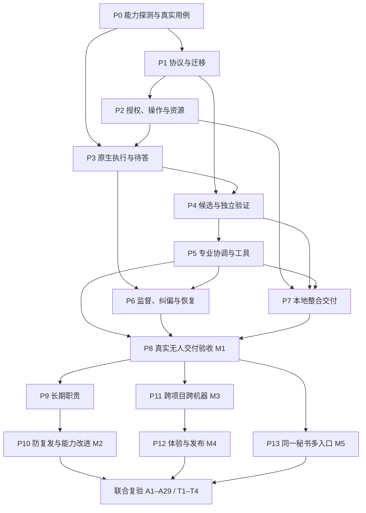

# Superagent 全自动托管实施计划

> **For agentic workers:** REQUIRED SUB-SKILL: Use superpowers:subagent-driven-development (recommended) or superpowers:executing-plans to implement this plan task-by-task. Steps use checkbox (`- [ ]`) syntax for tracking.

**Goal:** 优先打通当前项目一次真实、无人催办的专业交付闭环，再验证长期职责的连续闭环，最后扩展跨项目、跨机器和获授权后的发布。

**Architecture:** 保留通道、持久账本、唯一消息出口、桌子和适配器分层，迁移与目标冲突的状态、权限和结案语义。在同一服务域增加受控操作、专业协调、独立验证和交付能力；真实 Agent 的行为证据与结构测试分别验收。

**Tech Stack:** 仓库现有 TypeScript、Cordis、SQLite、Vitest、DSH 官方 SDK；原生 Codex App Server 适配版本由 P0 实测锁定，持久知识沿用 OpenViking。

**Spec:** [需求基线](01-需求基线.md)、[协议](02-协议.md)、[专业团队协作](14-专业团队协作.md)、[托管协调](12-托管协调.md)、[验收与评估](13-验收与评估.md)。本文是当前实施路线与能力缺口索引，具体执行记录、测试输出和临时交接放 Issue/PR 或交付记录，不在本页累积历史流水。旧 [实施批次](plan/PLAN.md) 不是本路线的完成证明。

## Global Constraints

- 本轮只制定计划，不写运行时代码、不启动真实执行任务、不改变现有服务模式。
- 全部宿主行为归 `packages/dsh-web-all/src/host/services/superagent/`；不增加运行时实体、不修改 DSH 源码。
- 既有授权持续适用；技术问题由系统调查、纠偏和处理，不能让老板重试、传话、选模型或裁决测试争议。
- 正常返工保持原执行及原评审线程；发布必须绑定老板明确批准的候选和目标。
- 不能降低验收、用模拟 Agent 轨迹代替真实自治，不能靠减少完成口径来消除失败。
- 保留当前未提交工作；计划执行前重新核对工作区、分支及并发工作。隔离方式服从项目规则，不能把工作目录登记当作真实 Git 隔离。
- 不得中断或重启当前运行的 DSH 服务。恢复实验只操作授权的独立测试实例；实际生效方式按 [HMR](../hmr.md) 判定。
- 原生协议、执行围栏或宿主能力不足须先修复或适配；不得静默改为不能续聊、不能接答或没有边界的执行方式。

## Review Focus

- 新需求、旧候选和旧授权并发到达：禁止旧版本继续交付，保留真实已发生副作用。由 P1/P2/P7 的版本竞争测试覆盖。
- 原生提问等待、正常调试和空跑混淆：有效等待不被杀掉，真正停滞必须由系统处理。由 P3/P6 的请求与诊断反例覆盖。
- 自报证据齐全但成果错误、验收判据自身误派生：独立验证拒绝坏产物，并可在不降真实要求的前提下纠正误报。由 P4/P5/P8 覆盖。
- 取消超时、会话撞名和重启：不能误杀别人、释放未知写者的锁、重派重复副作用或恢复人工停止的工作。由 P2/P3/P6 覆盖。
- 首轮完成后责任消失、失败经验只写不读：长期职责继续第二轮，改进在后续行为中可核对。由 P9/P10 覆盖。

## 核查口径与当前缺口

下列判断基于当前工作区源代码和测试阅读，包含未提交及未跟踪的 transport、恢复等改动；不是对部署实例的运行认证。实施前须固定实际输入版本并核对这些改动是否已整合，不能只从 HEAD 复制旧文件覆盖它们。代码注释中「对应当前设计」的宣称也必须逐项复核。代码导航工具不可用时可用符号搜索，不能因缺索引跳过调用链检查。

“已有底座”表示可以复用实现形状；“局部支撑”表示未闭合或未接线；“语义冲突”表示需要替换现有行为与相应旧测试；“缺失”表示本服务中未找到目标机制。已有测试通过不提升为真实托管能力认证。

| 能力 | 当前证据与结论 | 需要补齐或替换 | 任务 |
| --- | --- | --- | --- |
| 入站、持久账本、消息出口 | 已有底座：[claim](../../packages/dsh-web-all/src/host/services/superagent/kernel/claim.ts)、[ledger](../../packages/dsh-web-all/src/host/services/superagent/kernel/ledger.ts)、[outlet](../../packages/dsh-web-all/src/host/services/superagent/kernel/outlet.ts)、飞书通道及 shadow 接线 | 保留可用端口，加入新版状态、授权/版本门禁；首期可信老板指令与其他材料隔离 | P1/P2/P5 |
| 双形态责任及状态 | 语义冲突：[objects](../../packages/dsh-web-all/src/host/services/superagent/protocol/objects.ts) 仍为 deliver/watch/remind/goal 与 open/unverified/orphaned 等旧状态；[db](../../packages/dsh-web-all/src/host/services/superagent/protocol/db.ts) 的 SCHEMA_VERSION 为 1 | 独立 responsibility/commitment、合同版本、等待/控制状态、finding、专业分工、评估与交付记录；历史不重写 | P1/P9 |
| 工作落点与整合 | 局部支撑：[place](../../packages/dsh-web-all/src/host/services/superagent/world/place.ts) 有放置和权限查询；[attempts.prepareCwd](../../packages/dsh-web-all/src/host/services/superagent/executors/attempts.ts) 实际 mkdir seatRoot/work，而非已证明的仓库 checkout；branch 主要是登记 | 核实项目/仓库/工作区/基线、资源隔离和真正整合，保留用户改动 | P2/P7/P11 |
| 委派权限与控制 | 局部支撑且有冲突：[mandate](../../packages/dsh-web-all/src/host/services/superagent/world/mandate.ts) 有作用域求值；[translate](../../packages/dsh-web-all/src/host/services/superagent/judgment/translate.ts) 将 owner 的 draft 直接读成 allow；[owner-ball](../../packages/dsh-web-all/src/host/services/superagent/recovery/owner-ball.ts) 按旧记录自动提升 | 从真实请求推导具体授权，不用老板身份代替范围；Action、控制租约、epoch、资源锁和目标端围栏必须接线 | P1/P2 |
| 秘书与执行者工具边界 | 局部支撑：[toolface](../../packages/dsh-web-all/src/host/services/superagent/desk/toolface.ts) 有 restrict/guard，但另允许原生 subagent/team 调度；[executorGuard](../../packages/dsh-web-all/src/host/services/superagent/executors/profiles/guard.ts) 只有定义及直接单测，未找到生产装配调用 | 原生派发纳入同一操作与权限账本；执行者的真实工具、子进程和子 Agent 受围栏，不能只做名称过滤 | P0/P2/P3 |
| 原生会话与反向请求 | 局部支撑：[transport](../../packages/dsh-web-all/src/host/services/superagent/executors/transport/types.ts) 有 DSH http/inproc 的 create/prompt/cancel/snapshot/watch；[外部 Codex](../../packages/dsh-web-all/src/host/services/external-session/providers/codex.ts) 已有 CLI exec/resume，不能说仓库完全没有续聊 | Superagent 尚无 App Server 双向请求、原生绑定/控制、可靠消费证据链；CLI 续聊不是这些能力的等价替代 | P0/P3 |
| 派发、取消和续接 | 语义冲突：[attempts](../../packages/dsh-web-all/src/host/services/superagent/executors/attempts.ts) 按尝试生成新 session id，cancel 失败仍记 ended；[ensureExecutorSession](../../packages/dsh-web-all/src/host/services/superagent/executors/transport/bind-executor-session.ts) 会按 cwd 冲突取消重建或在 cwd 未知时重附着 | 稳定原生绑定、同线程返工、撞名先验证权属、取消/输入 unknown 的持久对账、失联不释放锁 | P2/P3/P6 |
| 专业组织和受控交办 | 缺失：[profiles](../../packages/dsh-web-all/src/host/services/superagent/executors/profiles/index.ts) 主要区分 oneshot/durable、read/full 和 cost tier；[commit](../../packages/dsh-web-all/src/host/services/superagent/judgment/commit.ts) 直接写 pending attempt | 按专业责任和能力组队，需求/技术决定/交付物/消费者/独立性/检查点可追溯；秘书可读取原始证据并安排复核 | P1/P4/P5 |
| 独立验收 | 语义冲突：[closure.readyOutcome](../../packages/dsh-web-all/src/host/services/superagent/executors/closure.ts) 可按单条命令、路径/分支存在或摘要词匹配直接 fulfilled；[index](../../packages/dsh-web-all/src/host/services/superagent/index.ts) 将 closure 接到终态与汇报 | ready 只能收集候选；独立评审、真实行为验证、逐项结论、错误判据纠正、原线程返工 | P4/P5 |
| 实际交付与发布 | 缺失：本服务未找到 delivery_step/候选授权与逐步骤回执；当前 deliver 常指消息 moment | 真实整合/提交、候选版本、目标回执和交付后观察；正式发布单独取授权 | P7/P12 |
| 语义监督与恢复 | 已有定时、对账、pending flush、时钟看门狗；但 [supervise](../../packages/dsh-web-all/src/host/services/superagent/executors/attempts.ts) 用 repeat_count≥3 取消，两个无工具窗口判停滞；[escalate](../../packages/dsh-web-all/src/host/services/superagent/executors/escalate.ts) 三次或无高档位即 broken，通知默认建议缩范围 | 根据成果/假设/等待诊断，预算不结束责任；秘书自身停摆也有独立诊断；恢复不得找老板接手未提交现场 | P6 |
| 持续主动维护 | 语义冲突：[goal](../../packages/dsh-web-all/src/host/services/superagent/timing/agenda/goal.ts) 周期提案；[propose](../../packages/dsh-web-all/src/host/services/superagent/judgment/propose.ts) 最多三子单、ball 在 owner，等待批准 | 职责授权内 finding 去重后直接执行，形成效果复查和第二轮，取消抑制与停/恢复语义完整 | P9 |
| 防复发与知识真源 | 局部支撑：本地 memory/rule 记录和 [replay](../../packages/dsh-web-all/src/host/services/superagent/rules/replay.ts) 存在，但以 changed_ratio≤10% 为门槛；[autonomy](../../packages/dsh-web-all/src/host/services/superagent/rules/autonomy.ts) 有五次批准升级的实现，未找到运行装配调用 | 不能把未接线逻辑当已发生扩权；接入前淘汰冲突规则。补 OV 引用、原因分类、保留案例、实际应用与回滚 | P5/P10 |
| 跨项目、跨机器与入口 | 有实体/别名、HTTP 目标与 status 命令；[db](../../packages/dsh-web-all/src/host/services/superagent/protocol/db.ts) 和 attempts 仍有全局单 slot/同线程单顶层任务；网页命令路由不等于秘书自然语言入口 | 父子版本与组合验收、资源维度并发、跨机控制；飞书/网页可信身份统一，体验候选 | P1/P11/P12/P13 |
| 证据和旧门禁 | [七步链](../../packages/dsh-web-all/tests/superagent-e2e-seven-step.spec.ts) 使用 scripted-agent/fake-controller；[检查脚本](../../scripts/superagent-check.mjs) 校验旧账本不变量 | 保留有效结构回归，替换与目标冲突的断言；新增真实 Agent 轨迹及负控，旧全绿不宣称目标完成 | P0/P8 及各任务 |

## 首个无人盯守闭环与交付边界

M1 的输入是一项在当前项目中已经可复现、明确授权的开发维护需求。由系统调查选取适合首轮的真实行为缺陷，优先不涉及托管控制面自身、生产数据、服务重启或必须由老板决定的体验取舍；不能用仅改文案、写报告或脚本模拟实现者来代替。选例必须先有用户可观察的错误与独立验证办法，没有合格问题就报告选例未就绪，不编造缺陷。

M1 的终点采用 [首个职责画像](12-托管协调.md#首个职责画像建议默认尚未启用)：符合要求的真实代码修复，经独立验证和当前项目门禁，整合后仅提交本事项改动到本地 dev，并给出真实提交与证据。该终点须写进具体合同，不默认推送、合并 main 或发布。用户若交办的终点是上线，则 M1 只能作为中间里程碑，不能单方面将其目标缩成本地提交。

M1 的责任覆盖仍完整：产品/技术分析可在低冲突席位兼任，秘书兼交付推进，实现与最终验证分离；质量从交办前参与，体验/专项/运行必须作适用性判定，必要时实际介入。不能退回“一个实施者加一次末端审查”并称专业团队已经成立。

M1 必须在用户发出初始委托后，不靠催办、传话、技术解答完成：调查与合同 → 组队 → 实施 → 技术待答接管 → 发现缺陷/停滞 → 自主纠偏 → 原线程返工 → 独立复验 → 精确候选整合与提交 → 结果汇报。重启、丢回执、正常等待和秘书空跑分别注入验证；不要求同一条长轨迹偶然遇到所有故障。

M2 在 M1 之后验证同一长期职责的两轮发现、修复、效果复查和经验应用。M3 验证两个项目、两台授权宿主及组合验收。M4 验证预览/本人体验与发布：只保留真实产品决定、本人体验和具体发布授权这些必要的人类动作，获批后的执行与排障不能再交回人。M5 完成网页同一秘书入口和其余产品能力；这些里程碑全部完成前，不宣称整个目标设计已实现。

## 依赖与实施顺序

P0 先消除原生协议和执行围栏的不确定性，P1/P2 再形成可依赖的契约。P4 的纯验证逻辑可在 P1 后准备，真实验证依赖 P3；P6/P7 可在相关接口稳定后按写域并行，组合根接线串行。P10 的样本/OV 端口准备可提前，但必须等 P9 的后续真实任务证明应用效果。先通过 M1 再扩执行范围，不等所有高级能力齐备才运行首个真实用例。

M1 的实现范围是一个真实项目、一种已经验证的原生执行端、一条可信入站通道和本地 Git 交付端口。协议保留跨目标身份与扩展边界，但不要求先实现所有适配器、角色组合和发布端口。权限、独立验收、原线程返工、过程纠偏、全双工查询和真实交付属于这条最小纵向链的必需部分，不能延期。知识库完整治理、多项目调度优化和网页体验可后续扩展，当前任务内的反思与换方法从 M1 起就要生效。

## 文件与接口约定

下文 `S` 为 `packages/dsh-web-all/src/host/services/superagent/`，`T` 为 `packages/dsh-web-all/tests/`。所有新路径是拟议实现位置，不是现存能力。每个任务只建立其必需文件；不得为每个岗位创建一个空模块。新 profile 是执行与知识配置，宿主模块仍按状态、操作、协调、验证等职责划分。

P1 在 `S/protocol/managed-work.ts` 声明 `Ref = { id: string; revision: number }`、`SessionIdentity = { host: string; provider: string; nativeThreadId: string }` 及目标协议类型：`CommitmentSpec/CommitmentSnapshot`、`ResponsibilitySpec/ResponsibilitySnapshot`、`AssignmentSpec`、`ActionSpec/ActionRecord`、`ExecutionEnvelope`、`InputRecord/InputReceipt`、`ExecutorRequest/RequestResponse`、`Candidate/EvidenceRef/Evaluation`、`ReviewIssue/ProfessionalDecision`、`DeliveryStep/DeliveryReceipt`、`Finding`、`ImprovementRecord/MethodApplication`。字段语义采用 [协议](02-协议.md)，序列化全部带 schemaVersion；状态值不得由适配器自行增加。下文接口均使用这些类型。

各任务测试命令为 `pnpm --filter @dsh-cove/dsh-web-all exec vitest run tests/<指定文件>`；本命令只运行指定测试，不触发配置/预设生成器。实现阶段仍须按项目要求运行构建、生成与全仓门禁，不能用此命令替代交付检查。每任务完成后独立评审并仅提交自身文件；本计划不预先给任何任务标 DONE。

### P0：确认执行能力与首个真实用例

依赖：无。产出为可决策的能力证据和用例，不直接启用生产托管。

**Files:** 读取 `S/executors/transport/{types,http,inproc}.ts`、`S/desk/toolface.ts`、`S/index.ts`、`packages/dsh-web-all/src/host/services/external-session/providers/codex.ts` 和实际部署版本的官方 schema；未来测试落 `T/superagent-native-capabilities.spec.ts`，真实探测记录放交付记录，临时探针不作为第二运行系统。

**Interfaces:** 提供版本绑定的能力报告：原生线程/回合/请求命名空间、resume/steer、实际输入消费证据、请求应答与失效、取消及子进程状态、工作区/网络/凭据围栏、事件补读和模型覆盖。能力分类为 verified/unsupported/unknown，每项附证据，不以 API 名称存在判通过。

- [ ] 在独立授权环境固定宿主、CLI/App Server 与 SDK 版本，读取真实协议，复核现有 http/inproc 和 CLI resume 可复用部分。
- [ ] 运行受限探测，断言同一 thread 跨回合/重连保持、真实审批可以绑定原请求响应、回执丢失可对账；绕过提示词的授权外写入被目标端阻止，取消要核对子进程。探测不操作当前 DSH 服务。
- [ ] 选定当前项目真实缺陷，冻结原行为复现、必需结果、独立判据和允许交付位置；测试评判依据不只来自未来实现者。
- [ ] 决定 P3 的原生适配具体版本及 P2 围栏组合：目标端受控代理配合可证明的沙箱/资源隔离；若缺能力，明确适配工程及阻塞项，不能回退标准预设或 CLI 自动审批冒充已满足。

### P1：目标协议、账本迁移和有效版本

依赖：P0。**Files:** 新建 `S/protocol/managed-work.ts`、`S/protocol/migrations/managed-work.ts`；修改 `S/protocol/{objects,db,tools,events}.ts`、`S/kernel/ledger.ts`、`S/recovery/startup.ts`；测试 `T/superagent-managed-protocol.spec.ts`、`T/superagent-managed-migration.spec.ts`。

**Interfaces:** `migrateManagedWork(db, fromVersion): MigrationReport`；`ManagedLedger.transact(expectedRefs: Ref[], proposals: ManagedProposal[]): CommittedRevision | Conflict`。`ManagedProposal` 是在 P1 同文件定义的受控命令联合，覆盖事项/合同、分工/交接、操作/回执、验收/审查、交付、职责/finding、改进与控制，不接受任意模型 SQL。为 P2–P13 提供只读快照及协议对象版本。

- [ ] 写迁移及状态反例：旧 unverified/orphaned 不无证据变 fulfilled；旧终态保留原事件；同线程两独立事项可共存；父要求/判据变化令旧派发与验收不可用；暂停/接管与进度分离。
- [ ] 运行这两个测试文件确认旧实现失败，保存失败断言；实施显式 schema 迁移和版本比较，重建与新状态冲突的 SQLite CHECK/索引，不能只 ALTER 加字段。
- [ ] 分开旧记录只读兼容和新调度准入，迁移前对账在途写者；旧进程拒绝新协议写入。保留通道认领、journal/outbox 幂等及历史证据，不将回退实现为删表或重新执行副作用。
- [ ] 迁移统一 100 词的数据库约束，为按通道和消息用途表达保留空间；只实现 M1 使用的写入命令及校验，后续职责/学习等命令按相应阶段启用，未启用命令明确拒绝。
- [ ] 复测崩溃窗口与重复迁移；所有结构类型、变更事件和下游消费版本一致，新增旧数据映射说明后提交。

### P2：授权、操作事实、控制租约和真实资源

依赖：P1 与 P0 围栏证据。**Files:** 新建 `S/kernel/{actions,control,resources}.ts`、`S/world/workspaces.ts`；修改 `S/world/{mandate,registry,place}.ts`、`S/judgment/translate.ts`、`S/recovery/owner-ball.ts`、`S/desk/toolface.ts`；测试 `T/superagent-actions.spec.ts`、`T/superagent-control-fence.spec.ts`、`T/superagent-workspaces.spec.ts`。

**Interfaces:** `planAction(spec: ActionSpec): ActionRecord`、`authorizeAction(actionRef: Ref): ExecutionEnvelope | Denial`、`recordActionResult(actionRef: Ref, receipt: ActionReceipt): ActionRecord`；`ActionReceipt` 在 `actions.ts` 定义 confirmed/failed/unknown 及可核查引用，`Denial` 含协议错误码与依据。`claimResources(actionRef: Ref, resourceIds: string[]): ResourceLease[]`、`revokeControl(target: Ref, source: Ref): ControlReceipt`。后两类回执在各自模块定义 epoch、期限、目标和确认状态，不能用消息出口租约替代。

- [ ] 写反例：owner 身份不将超范围 draft 变 allow；非老板消息和报告伪造授权无效；raw subagent/team 调度无法绕过 Action；跨路径/符号链接/子进程写入、撤销后旧 epoch、共享分支双写均被拒绝。
- [ ] 运行指定测试确认失败，实施授权来源/范围解析、操作先落账、执行前再校验、目标端围栏及资源锁；普通工程授权不包含发布。
- [ ] 核实仓库身份、基线 SHA、已有修改及目标工作区，建立符合项目规则的隔离；禁止只是 mkdir 空目录却登记为已准备仓库。资源同时按仓库/分支/共享环境识别，不能只锁本机路径。
- [ ] 复测发送后丢回执、取消未确认、数据库不可写及紧急停止：未知不能变成功或释放可能仍写入的资源；可达停止以设计的 60 秒预算验证。提交前核对没有通用 shell 暴露给秘书。

### P3：Codex 原生绑定、消费证明和反向请求

依赖：P0/P1/P2。**Files:** 新建 `S/executors/native/{adapter,bindings,requests}.ts`；修改 `S/executors/{attempts,events,report-tool}.ts`、`S/executors/transport/{types,index,bind-executor-session}.ts`、`S/index.ts`；测试 `T/superagent-native-sessions.spec.ts`、`T/superagent-native-requests.spec.ts`。

**Interfaces:** `attachNative(identity: SessionIdentity, envelope: ExecutionEnvelope): SessionBinding`、`sendNativeInput(binding: Ref, input: InputRecord): Promise<InputReceipt>`、`listNativeRequests(binding: Ref): Promise<ExecutorRequest[]>`、`respondNativeRequest(request: Ref, response: RequestResponse, envelope: ExecutionEnvelope): Promise<ActionReceipt>`、`collectNativeEvents(binding: Ref, cursor?: string): Promise<NativeEventPage>`。`SessionBinding` 和 `NativeEventPage` 在 adapter.ts 定义命名空间、控制版本、游标完整性和来源，适配器只报告事实。

- [ ] 写原线程正常返工、输入 accepted 但未 consumed、过期审批、未知请求、重启清除请求、丢应答回执、线程撞名和外部接管的反例。
- [ ] 运行指定测试确认失败，按 P0 锁定协议接入创建/恢复、空闲续交和活跃 steer，持久化真实 nativeThreadId；normal retry 不改变角色绑定，不按尝试编号创建替代线程。
- [ ] 把技术提问/审批变成可持续等待对象，接到 P5 协调提案与 P2 Action；对 clear/resolved 只记录解除原因，不认为工具已完成。技术 blocked 无需硬凑给老板的问题。
- [ ] 在独立真实端复测持久输入及回合证据、断线补读、取消真实子进程和控制撤销；http/inproc 的未验证能力不得自动宣称等价。外部 CLI resume 的已有能力可复用，但不得用其替代未实现的双向原生请求。

### P4：版本化候选、独立验收与审查问题

依赖：P1，真实执行依赖 P2/P3。**Files:** 新建 `S/verification/{candidates,evidence,assess,issues}.ts`；修改 `S/executors/{closure,events}.ts`、`S/kernel/ledger.ts`、`S/index.ts`；测试 `T/superagent-verification.spec.ts`、`T/superagent-review-issues.spec.ts`，迁移 `T/superagent-executors-closure.spec.ts`。

**Interfaces:** `collectCandidate(assignment: Ref, evidence: EvidenceRef[]): Candidate`、`assessCandidate(contract: Ref, candidate: Ref, evidence: EvidenceRef[]): Evaluation`、`recordReviewIssue(issue: ReviewIssue): Ref`、`resolveReviewIssue(issue: Ref, evaluation: Ref): Ref`。验收产出验证请求由 P5 派发，模块不直接调执行器；宿主检查证据绑定与独立性，模型负责需语义判断的专业结论。

- [ ] 写坏产物反例：路径存在、摘要含关键词、无真实 exit 的日志、相同命令但不同产物/环境、实现者自签或遗漏用户场景均不能通过；未知证据返回 inconclusive，不能终态结案。
- [ ] 跑测试证明旧 closure 会错误放行，再改为 ready → candidate → verifying；候选绑定实际 tree/commit 或内容摘要、环境和合同版本，不能只绑定可变路径。
- [ ] 实施 pass/fail/inconclusive 的逐项结论、生成参与关系、缺陷责任/解除条件与独立复核；保留被推翻的误报及证据，不删除历史。
- [ ] 验证旧行为负控、项目门禁和真实原始证据；验收者也用已知好/坏/缺证据样例校准。各类失败可回原线程，不把评审 ready 当作总事项完成。

### P5：专业协调、受控工具和内部技术决定

依赖：P1–P4。**Files:** 新建 `S/coordination/{intake,team,advance,decisions}.ts`；修改 `S/judgment/{commit,amend-release,translate}.ts`、`S/desk/{tools,dossier,now,presence}.ts`、`S/memory/docs.ts`、`S/executors/profiles/{types,index}.ts`、`S/timing/outlet-policy.ts`、`S/index.ts`；更新 `packages/dsh-web-all/presets/superagent-{desk,executor}/{agent.cordis.yml,preset.yml}`，用 `scripts/render-preset.mjs` 生成对应 patch，不能手改生成物。测试 `T/superagent-coordination.spec.ts`、`T/superagent-professional-team.spec.ts`、`T/superagent-desk-tool-contracts.spec.ts`，同步现有 preset 测试。

**Interfaces:** `acceptManagedIntent(source: Ref, spec: CommitmentSpec): Ref`、`planProfessionalTeam(commitment: Ref, assignments: AssignmentSpec[]): Ref[]`、`advanceManagedWork(commitment: Ref): CoordinationProposal[]`、`recordProfessionalDecision(decision: ProfessionalDecision): Ref`。`CoordinationProposal` 在 advance.ts 声明为 Action、验证请求、合同/分工修订、等待或 outbox 提案联合，全部经 P1/P2 校验执行。

- [ ] 写责任漏项、过度兼任、无实质待决却等批准、技术问题转老板、角色交接无人负责及原始目标被指标替代的失败场景。
- [ ] 运行指定测试确认失败；建立目标→专业责任→交付物→消费者→验收映射，首次交办前由质量责任检查判据；简单事项兼任有理由，高风险独立领域角色必须实际具备能力。
- [ ] 实施 look/plan/operate/verify 等目标逻辑能力，读取有范围和版本的原始证据并分页，不截断必需条件；原生调度工具要么由受控桥接接入账本，要么在秘书面移除，不能有两条派发通路。
- [ ] 在首条通道验证执行与讨论/查询/追加/停止并行，动态事实不被固定窗口指纹冻结；通知简洁而讨论保留必要分析。按实际受众过滤原始材料和交办上下文，非老板材料不触发控制，拒绝有依据与替代方案，对外代理身份明确。
- [ ] 接答 P3 技术请求、准备真正用户决定；落实专业争议的复现和独立复核、误派生判据修正、原执行/评审线程返工；记录失败签名和当前任务采用的方法，为 P10 保留运行证据。
- [ ] 验证专业决定与用户裁定分开、合同变更后旧结论失效、交接绑定原子切换；补齐源预设和目标模块依赖测试再提交。

### P6：语义监督、持续恢复与秘书自身监督

依赖：P2/P3/P5；与 P7 可分写域推进。**Files:** 新建 `S/coordination/{supervision,diagnosis}.ts`；修改 `S/executors/{attempts,budget,escalate}.ts`、`S/recovery/{reconcile,startup,clock-watchdog,pending-flush,owner-ball}.ts`、`S/kernel/clock.ts`、`S/timing/agenda/index.ts`；测试 `T/superagent-supervision.spec.ts`、`T/superagent-managed-recovery.spec.ts`。

**Interfaces:** `diagnoseProgress(commitment: Ref, observations: EvidenceRef[]): Diagnosis`、`proposeRecovery(diagnosis: Diagnosis): CoordinationProposal[]`、`reconcileManagedWork(now: number): RecoveryObservation[]`。diagnosis.ts 定义 `Diagnosis` 的事实、假设、失败签名、待核实点、责任角色、建议及预期证据；恢复 observation 只提供事实和可安全修复投影，业务动作回 P5。

- [ ] 写反例：三次同命令但有真实进展不取消；超过三次尝试不自动 broken；等待请求不误判空跑；真实重复无新证据必须更换假设/方法；取消失败保留未知与锁。
- [ ] 跑测试确认旧规则失败；将工具/时间计数改为诊断信号，移除默认缩范围和固定档位终止；预算保全单次尝试，事项仍有下一步或有效等待。
- [ ] 重建未消费输入、请求、候选、未关闭审查、交付回执和检查点；不得只检查会话是否存在。替换恢复中按名字取消未知会话、durable 失联直接让老板接手和自动提升提案等旧路径。
- [ ] 加入秘书到期不处理/重复无效决定的独立诊断触发；协调换代隔离旧写者，同账本续接，遵守人工停止/接管；有效等待不能被当失职。
- [ ] 故障注入丢 turn/end、响应未知、协调进程崩溃及定时器停摆，确认原生线程与责任不断、无重复副作用、无向老板发送技术待办；重要失败仍按承诺时点预警。

### P7：真实本地整合、提交和交付回执

依赖：P2/P4/P5。**Files:** 新建 `S/coordination/delivery.ts`、`S/executors/delivery/local-git.ts`、`S/verification/delivery.ts`；修改 `S/surface/{moment,templates}.ts`、`S/timing/outlet-policy.ts`、`S/index.ts`；测试 `T/superagent-managed-delivery.spec.ts`。

**Interfaces:** `prepareDeliveryStep(step: DeliveryStep): ActionSpec`、`executeLocalGitDelivery(step: DeliveryStep, envelope: ExecutionEnvelope): Promise<DeliveryReceipt>`、`verifyDeliveryReceipt(step: Ref, receipt: DeliveryReceipt): Evaluation`。实际 Git 操作由受限交付执行角色/端口完成，秘书无通用 shell；确认回执须包含目标仓库/分支、实际提交、精确候选和作用范围。

- [ ] 写反例：报告完成却没有提交、候选在审查后变化、目标 dev 前进、用户已有暂存改动、提交已发生但回执丢失；不得误提交别人的文件、覆盖新提交或重复交付。
- [ ] 跑测试确认旧消息 deliver 无法满足；实施资源加锁、核对基线、整合冲突自主处理或重做候选，并在最终待交付版本重跑受影响验证与项目门禁。
- [ ] 只提交本事项改动，持久核对提交和目标；新补充需求阻止旧的未执行步骤，已执行部分只对账。全部必需验收与实际交付满足后才 fulfilled，再发结果。
- [ ] 复测未知回执与恢复，汇报准确区分本地提交、推送、上线和效果；此阶段不增加生产发布权限。

### P8：真实无人盯守闭环验收（M1）

依赖：P0–P7。**Files:** 新建 `T/superagent-managed-e2e.spec.ts`、`scripts/superagent-managed-check.mjs`；修改 `T/superagent-e2e-seven-step.spec.ts`、`T/superagent-parity.spec.ts`、`T/superagent-deps.spec.ts` 及 `scripts/superagent-check.mjs` 的版本识别/说明。不得降低旧安全检查，失效断言逐条映射到新需求；真实运行输入、日志和证据存交付记录。

**Interfaces:** 新检查器接受 `--evidence <manifest>`，manifest 包含测试 case、固定合同/候选、角色/原生绑定、授权/Action、消费、审查、交付/观察证据和用户介入事件。退出码沿用 0=覆盖判据通过、1=失败、2=参数/IO、3=缺证据；缺真实 Agent 轨迹时不得返回整体通过。机器结构判定不冒充语义质量，必须引用独立评估结果。

- [ ] 先写结构装配测试，断言完整事件链从输入到真实交付状态，且故意缺失独立评审/消费/交付回执时失败；脚本化版本只归结构证据。
- [ ] 在独立授权实例运行 P0 真实缺陷，让真实秘书和专业执行体完成 M1；除初始委托，用户不给调度提示或技术答案。记录关键原生身份、产物变化、检查和最终本地 dev 提交。
- [ ] 分支验收：质量退回后原线程返工，技术请求自动回答，正常调试不误杀，空跑改方法，秘书停摆被诊断，重启/丢回执恢复不重派；错误派生判据由内部复核纠正而不减真实要求。
- [ ] 做独立负控：撤掉验收、恢复旧 closure、去掉消费校验或恢复三次失败终止，相应案例必须失败。所有用户介入按主动讨论、真正决定和被迫救场区分；需要人救场的运行计失败，不从分母删除。
- [ ] 通过相关测试、`pnpm typecheck`、`pnpm test`、`pnpm test:scripts`、`pnpm docs:check`，加受影响构建与真实环境证据；有行为修复保留旧行为失败检查名。完成这一步才可宣称 M1，不能以“能派单”提前交付。

### P9：长期职责、发现去重和第二轮自主推进

依赖：M1。**Files:** 新建 `S/coordination/{responsibilities,findings}.ts`；修改 `S/timing/agenda/{goal,watch,index}.ts`、`S/judgment/propose.ts`、`S/kernel/clock.ts`、`S/surface/commands/{status,stop}.ts`；测试 `T/superagent-responsibilities.spec.ts`、`T/superagent-standing-e2e.spec.ts`。

**Interfaces:** `registerResponsibility(spec: ResponsibilitySpec): Ref`、`reviewResponsibility(ref: Ref, facts: EvidenceRef[]): Finding[]`、`admitFinding(finding: Finding): Ref | FindingDisposition`。findings.ts 定义 merged/admitted/observe/suppressed/declined 的处理结果与理由、已有事项引用和下一复查，非终态不可无主。

- [ ] 写授权内缺陷自动受理、重复信号只一单、无问题不造活、同职责两轮、暂停/撤销/取消抑制及恢复的反例，证明旧“提三条等批准”不能通过。
- [ ] 接入一个真实授权观察源，从发现、价值判断到 M1 全链复用；观察失效和无新事件仍有最晚复查，不能无限推迟。
- [ ] 运行 T1 与 A2/A10/A14/A23：首轮结束后无用户新派活，自行发现第二个问题并交付；中途控制面/执行端故障恢复后职责 identity 不变。记录后置效果与无问题区间。
- [ ] 验证被取消问题不靠换 id 重开，复发有真实新事实和授权依据，缺权限只阻塞相关部分；提交并进入 P10 的实际应用验证。

### P10：专业经验、OV 真源与能力持续校准（M2）

依赖：P5 运行记录与 P9 后续任务；可提前开发只读检索和离线评估。**Files:** 新建 `S/memory/knowledge-port.ts`、`S/rules/{improvements,method-evaluation}.ts`；修改 `S/memory/{log,recall,docs}.ts`、`S/rules/{replay,autonomy,registry}.ts`、`S/desk/dossier.ts`、`S/timing/speculation.ts`；测试 `T/superagent-improvements.spec.ts`、`T/superagent-knowledge-boundary.spec.ts`。现有 memory-view 只读 OV 客户端可参考其连接边界，但不能复制凭据或建立第二知识权威。

**Interfaces:** `proposeImprovement(record: ImprovementRecord): Ref`、`evaluateImprovement(ref: Ref, holdout: EvidenceRef[]): Evaluation`、`recordMethodApplication(application: MethodApplication): Ref`；knowledge-port.ts 定义 `recallKnowledge(scope: Ref, query: string): Promise<KnowledgeRef[]>` 与 `publishKnowledge(candidate: Ref): Promise<KnowledgePublication>`，返回 OV URI/版本/同步状态，不写本地技能镜像。

- [ ] 写未召回、召回未消费、已用无效、误泛化、OV 不可用、空样本和规则变化超过 10% 但实际纠错的反例；连续批准不能生成新授权。
- [ ] 按专业原因把失败落实为场景/契约/回归/验证器/工作方法改进，代码改进走工程事项；候选评估使用保留案例及权限/隐私反例，不只比较结论变化率。
- [ ] 在 P9 第二轮或另一后续真实任务中核对方法版本、使用理由、实际行动与结果，再用不适用项目验证不会乱套；已有知识与运行记忆迁移保持唯一真源。
- [ ] 验证 R9 的后台预备与链式召回只读或形成草案；正式工作依靠明确事项/职责授权，不以推测偏好派单。按实际受众和专业范围过滤知识，保留召回来源和未使用理由。
- [ ] 能力/验收者评估失败限制角色范围并安排修复，退化可回滚；通过 A13/A20/A27/A28 和 T4 的后续应用段后才宣称持续改进有效。

### P11：跨项目、跨宿主和成果组合（M3）

依赖：M1；P1/P2 已有版本和资源语义。**Files:** 新建 `S/coordination/{dependencies,scheduler}.ts`、`S/verification/composition.ts`、`S/world/project-init.ts`；修改 `S/world/{registry,resolve,place}.ts`、`S/executors/native/adapter.ts`、`S/executors/transport/{endpoint,http}.ts`；测试 `T/superagent-multiproject.spec.ts`、`T/superagent-crosshost-e2e.spec.ts`。

**Interfaces:** `bindDependency(parent: Ref, child: Ref, required: boolean, outputs: Ref[]): Ref`、`schedulePortfolio(commitments: CommitmentSnapshot[]): AssignmentSpec[]`、`assessComposition(parent: Ref, candidates: Ref[], evidence: EvidenceRef[]): Evaluation`。依赖不能成环，改变祖先版本会使下游 Action 失效；资源隔离成立才并行。

- [ ] 写同名仓库/线程跨机、祖先版本变更、各子项通过但组合失败、资源争用、插单饥饿和部分交付的反例。
- [ ] 登记第二项目和第二授权宿主，逐目标验证 P0/P2/P3 能力；改用完整 host/provider/nativeThreadId 身份及规范资源，不能把本机路径或出口租约当跨机互斥。
- [ ] 运行 T2 与 T3 的跨目标/原生团队部分：实际两项目产物及接口组合，插单/断线/权限变化后恢复，未受影响分工继续；先验证候选组合再交付，避免父子互等结案。完整 T3 还依赖 P13 的第二入口，须在联合复验重跑，不能将此阶段片段记为整条通过。
- [ ] 补齐 R36/A19 的新项目初始化端口与恢复案例：创建、初始化、远端公开各有阶段授权和回执；保留存量工作区现场，部分成功后不重复创建。所需操作仍经 P2，不以项目发现自动获得授权。
- [ ] 若涉及宿主路由/启动器/远程入口，按远程访问契约运行其规定测试与 `pnpm dsh-netbird:audit`；在未通过前不将跨机能力列为可用。

### P12：候选体验、具体发布授权与运行观察（M4）

依赖：P4/P7/P11；单目标预览准备可提前，不能提前声称跨目标发布已完成。**Files:** 新建 `S/coordination/{previews,releases}.ts`、`S/verification/experience.ts`、`S/executors/delivery/registered-port.ts`；修改 `S/timing/outlet-policy.ts`、`S/surface/commands/index.ts`；测试 `T/superagent-preview-release.spec.ts`、`T/superagent-release-e2e.spec.ts`。

**Interfaces:** `preparePreview(commitment: Ref, candidate: Ref): ActionSpec`、`requestRelease(step: Ref, evidence: Ref[]): ReleaseRequest`、`applyReleaseDecision(request: Ref, trustedInput: Ref): Ref`、`verifyDeliveryEffect(step: Ref, observations: EvidenceRef[]): Evaluation`。releases.ts 定义 ReleaseRequest 的候选、目标、合同、前置证据、风险/回滚/观察和有效性；注册交付端口接受 P2 信封返回 DeliveryReceipt，不向秘书开放 shell。

- [ ] 写预览可用但未获发布授权、体验旧版本反馈、候选/目标变更导致旧批准失效、部署成功但观察不通过、批准后回执丢失的反例。
- [ ] 在验证阶段准备可访问且有版本证明的候选；本人体验反馈只绑定对应项，拒绝返工；产品无主观必需项时不制造人工验收。
- [ ] 准备具体发布证据后取得老板授权，自动执行逐步骤交付与补救/观察；前后置判据分开，不要求部署前拿到部署后效果。
- [ ] 运行 A18/A23/A29 及 T4 发布段；批准之后仍无需人操作或排障，未授权动作不能因事故发生自动取得权限。

### P13：同一秘书的网页入口与完整产品覆盖（M5）

依赖：M1；与 P9–P12 可按写域安排。**Files:** 修改 `S/surface/routes.ts`、`S/desk/{presence,dossier,now}.ts`、`S/channels/feishu/inbound.ts`；新增网页入站适配 `S/channels/web/inbound.ts`；客户端拟在现有 `packages/dsh-web-all/src/client/conversation/index.ts` 装配 `superagent-entry.tsx`、`superagent-api.ts` 和相应 `.test.tsx`/`.test.ts`。执行前核实官方会话扩展端口，保留原生输入与会话能力，不复制整套聊天 UI；宿主测试 `T/superagent-multientry.spec.ts`，另需真实 GUI 证据。

**Interfaces:** 网页将已认证身份映射至同一 party，以源事件 id 和实际受众进入 P5 的 `acceptManagedIntent` 及统一查询/控制路径；不引入第二套项目状态。状态投影扩展专业责任、审查、当前交付阶段和恢复点。

- [ ] 验证飞书受理、网页查询/纠偏、回飞书续谈使用同一责任和合同；同线程多事项、多窗口并发及隐私过滤不串线。
- [ ] 将 P5 已验证的动态上下文、可分页证据和通知策略接入网页，并验证两端受众及长度规则；承诺的更新时间不能被普通通知限额吞掉。
- [ ] 真实 GUI 验证对话与后台执行全双工、停止/接管即时可用；面板不产生第二真源。[桌子](07-桌子.md) 的下一句预测在入口稳定后独立交付，建议文本永不自动派单，不占 M1 关键路径。
- [ ] 对 A1–A29、T1–T4 及 R1–R44 做最终追踪；R14 保持预留、R17 保持作废，其余每项保留实际实现、证据及尚未通过的限制，不能把阶段完成误记为全产品完成。

## 实施准入与最终自检

每任务的指定测试先证明旧行为或缺失能力确实失败，再实现；行为修复按项目规则恢复旧行为验证新检查失败，随后恢复修改。不得删除有价值的旧断言来获得绿色：需要替换的是与当前目标冲突的业务口径，幂等、权限、隔离、停止、披露和回执可靠性仍需保留或加强。

P0 的不确定性属于执行能力调查，不由老板选择协议或排障路线。存在不可自行补齐的目标授权或本人登录需求时，系统提供具体目标、入口和已完成准备；其他工作继续。本计划不授予测试宿主、生产、跨机器或发布权限。

任务映射：协议/世界/内核为 P1–P3；专业协作/判断/桌子为 P4–P6/P13；验收/交付为 P4/P7/P8/P12；持续职责为 P9；记忆/规则为 P10；跨目标为 P11；消息策略贯穿 P5/P6/P7/P13。高风险反例均有对应任务，原生回投、目标不降标和发布授权不因分期被削弱。

| 必须保留的验收范围 | 主要落地任务 | 联合验证条件 |
| --- | --- | --- |
| A1/A5–A11/A14/A16–A17/A21/A24–A26/A28 | P1–P8 | 首个真实闭环及各故障分支；专业能力、过程反思、错误判据纠正均不能延期 |
| A12/A15 | P2/P5，P13 扩到网页 | 首期通道已具备可信身份、隐私、连续对话和全双工；再做双入口复验 |
| A2 与 T1 | P9，复用 P1–P8 | 同一长期职责连续两轮、无问题区间和恢复；不是两次人手重新启动 |
| A13/A20/A27 | P5/P10 | 当前纠偏与后续同类任务实际应用，包含不适用项目反例 |
| A3/A4/A19/A22 与 T2 | P11 | 两项目、两宿主的真实资源、初始化、依赖与组合证据 |
| A18/A23/A29 | P7/P9/P12 | 交付阶段适用性、真实效果观察与具体发布授权 |
| 完整 T3 | P11/P13，复用 P1–P8 | 两入口、两项目、原生团队续接及组合交付在同一连续轨迹成立 |
| 完整 T4 | P10/P11/P12，复用 P1–P8 | 专业风险发现、内部争议、发布和后续方法应用在连续轨迹成立 |

P13 的网页能力可提前完成，但最终产品验收依赖 P9–P12 全部就绪。联合复验必须重跑完整 T3/T4；各阶段片段的通过不能拼接成从未发生过的完整轨迹。需求追踪保留 R14 的预留和 R17 的作废状态，不擅自增做代接他人请求，也不恢复已作废指标。

实施顺序的首要验收是 M1 的真实行为，随后是 M2 的无人派活与实际学习。角色数量、代码行数、工具次数、旧测试通过数和文档齐全度均不作为进度代理。当前计划不对整体完成时间作无依据承诺；P0 固定能力与迁移基线后，由交付推进责任按任务与风险给出可核对估计。
