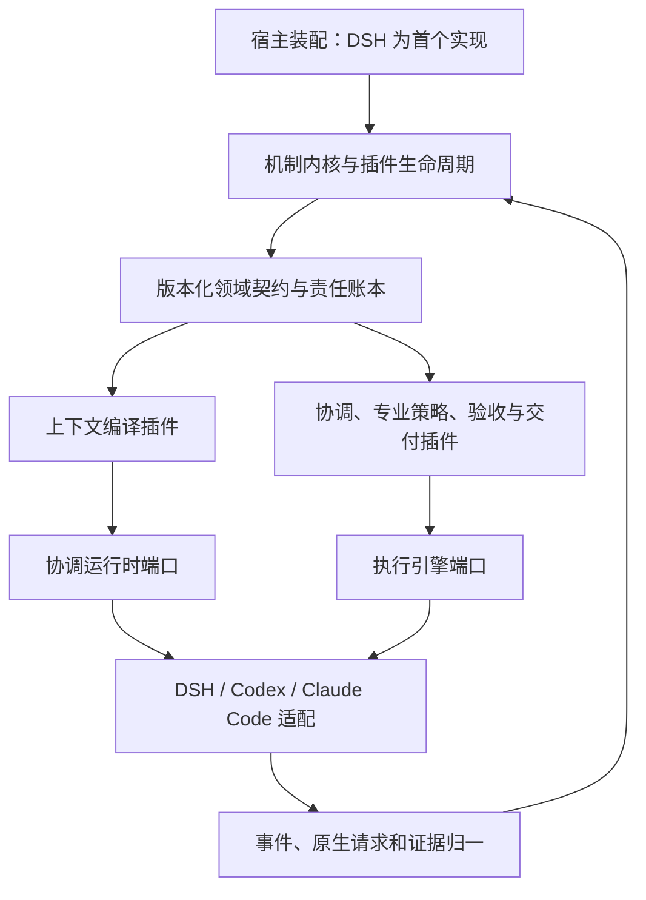

# 架构与扩展：领域模型、插件与在线演进

本文定义目标架构，不声明当前实现已具备插件热替换或多引擎等价能力。领域对象与不变量归 [协议](02-协议.md)，业务质量归 [专业团队](14-专业团队协作.md)，实施依赖归 [实施路线](15-实施路线.md)。扩展性以新增能力、兼容迁移和在途工作连续性的实际验证为准。

## 架构取舍

| 路线 | 收益 | 代价与结论 |
| --- | --- | --- |
| 固定模块加分支，全部能力直接依赖 DSH | 首轮接线短 | 新引擎、新业务类型和升级语义不断侵入协调代码，不作为目标 |
| 稳定机制内核、版本化领域契约、可替换能力插件 | 核心责任连续，执行与业务策略可独立演进 | 需要生命周期、能力测试及迁移；采用此路线 |
| 首期即做插件市场、任意脚本装载和分布式微服务 | 独立部署空间大 | 引入供应链、通信和多副本复杂度，延误真实闭环；不作为首期前置 |

“一切都是插件”落实为所有业务能力和外部依赖通过版本化扩展契约装配，包括内置能力；不是把每个函数变成插件，也不是允许插件绕过统一权属与完成判定。引导层负责可信装载、依赖解析和内核启动；机制内核负责事务、授权执行、版本/租约、幂等及生命周期。内核实现本身也可版本化升级，但改变不变量或存储语义须显式迁移，不允许普通插件覆盖安全规则。

首期维持 `packages/dsh-web-all` 唯一 Cordis 运行时实体，能力插件是其中注册的逻辑模块，不新增第一方实体行或包。进程外执行端、原生 Agent 和既有运维恢复者通过端口接入，不变成第二业务控制面。无需立即建设独立服务，领域逻辑须能够脱离 DSH SDK 在契约宿主中运行。

## 分层与依赖

图示为运行数据流，不是 import 环。领域 schema 和端口无宿主依赖；内核不 import 业务插件；插件依赖声明的端口和领域契约；适配器将外部事实转换后提交内核；组合根注入实现。模块间不直接读取另一个插件的私有表、闭包或内部文件。跨插件业务事实通过版本化查询、命令和事件表达，事件订阅不能绕过 Action 或自行增加权限。

仓内 import 守卫将 `plugins/` 声明为宿主无关的契约与生命周期域，仅允许域内引用；`adapters/` 可引用 `plugins/`、`protocol/` 和 `kernel/` 以实现端口、归一事实并提交内核。`kernel/` 仅引用自身与 `protocol/`，不引用适配器、插件实现或宿主 SDK；`plugins/` 同样不引用宿主 SDK。组合根负责注入实现；未声明目录不自动获得依赖权限。

`verification/` 组合版本化验收事务与独立执行端口，只依赖 `protocol/`、`kernel/` 和 `executors/`。其 canonical schema 属于协议，事务与实时适用性门禁属于内核，隔离进程适配属于执行体；内核不得反向引用验收实现。验收服务不派发 Agent 或修复任务，验证请求和后续责任仍由协调者组织。

领域内核不包含 DSH Context、原生 Session 事件结构、Codex RPC 名称、CLI argv 或厂商模型枚举。协议可保留带来源的原始载荷引用用于诊断，但协调策略只消费已验证的规范事实。未知事件保留并明确能力缺口，不能把不理解的原生类型当完成。

## 插件契约

每个插件有 manifest：`id/namespace, version, contract_version, provides[], requires[], compatible_schema_versions, config_schema, owned_state_schemas, migration_refs, permission_requirements, isolation_mode, reload_class, contract_test_refs`。提供和依赖按端口及版本范围解析；配置值不等于授权。内置插件走同一注册、兼容检查和测试入口，不能靠名字获得特殊旁路。

| 扩展点 | 负责 | 不可自行决定 |
| --- | --- | --- |
| 通道与宿主适配 | 认证身份映射、归一消息、配置/时钟/文件/进程能力、生命周期 | 正式受理、任务完成或业务授权 |
| 协调运行时 | 在受控工具面上运行秘书推理、返回提案与调用事实 | 获得业务仓库任意写权限 |
| 执行引擎与传输 | 原生会话、输入、待答请求、取消、观察和成果回收 | 修改责任与验收状态，伪造支持能力 |
| 专业策略与工作方法 | 分工建议、风险识别、诊断与优先级提案 | 绕过合同或把技术争议交回用户 |
| 观察源与领域类型 | 新信号、实体/关系 schema、领域约束和变化影响规则 | 将发现直接解释成新授权 |
| 上下文编译与知识连接 | 按角色/用途组织来源明确的上下文，访问 OV 引用 | 建立第二份目标、偏好或任务真源 |
| 验证器与交付端口 | 受限验证、原始证据、具体目标交付回执 | 自授发布权或单方面宣布整个目标完成 |
| 存储与观测适配 | 实现事务、游标、事件/回执保存及诊断 | 改变幂等、隔离、耐久或失效语义 |

插件生命周期至少为 discovered → validated → prepared → active → draining → retired；失败可 quarantine。prepare 只校验和准备，不执行业务副作用。激活前依赖、配置、能力及权限满足；同一端口的活跃提供者和代次明确。旧版本存在在途引用时不能直接卸载；缺依赖仅阻塞受影响工作，不能静默换较弱实现。依赖环拒绝激活。插件私有状态同样声明 schema、迁移与保留策略，但不能成为跨模块事实的隐含权威。

插件安装或升级属于工程变更，完成代码/供应链与契约验证后，才按对应目标授权激活；工作方法学习不直接安装代码。首期同进程插件是经审核的可信代码，端口约束与 import 检查不构成恶意代码沙箱。不可信扩展必须在经验证的进程/权限隔离中运行；未建立隔离时拒绝装载，不能把“一切插件化”解释为任意脚本执行。

## Agent 与宿主可替换性

必须分开四类身份：`engine_ref` 标识 DSH/Codex/Claude Code 的适配器及版本，`model_route` 标识 API provider/model/effort，`transport_ref` 标识本进程/HTTP/stdio 等连接方式，`host_ref` 标识实际机器。`session_binding` 保存这些引用及原生不透明会话 id；同一宿主同一引擎的不同存储实例/账号域以稳定 runtime_namespace 区分，连接重建不改变该身份；不能把换 API 模型、换引擎、换机器和换通信方式当成同一配置项。

默认引擎优先级及资格不足时的选择规则归 [执行体](10-执行体.md#执行体会话与分工)，同样适用于协调运行时。

`CoordinatorRuntimePort` 运行秘书的受限协调回合；`ExecutorPort` 承接专业分工；两者可共享引擎适配实现，但工具、权限、上下文与能力资格分别验证。仅接入多个执行端不等于秘书运行时已可替换。`HostPort` 承担 DSH 目前提供的装配、认证、存储位置、时钟和生命周期，替换宿主不要求改领域规则。首期只交付 DSH 宿主，使用独立契约宿主验证依赖边界，不承诺另一个生产宿主已可用。

执行端声明 create/attach/resume、输入消费、active steer、反向请求、事件补读、真实取消、围栏、隔离验证等能力，每项有版本、实测证据、限制和有效性。协调者按角色所需能力选择，不能压成所有引擎的最低共同能力，也不能硬要求所有引擎支持一个厂商 RPC。Codex 原生细节仅属于其适配器；Claude Code 或 DSH 的能力由各部署版本验证后声明，CLI 能输出文字不等于可承担全自动角色。

同一引擎内正常追加、热更重连及返工保持原原生绑定。更换引擎是显式交接：保全原成果和未决请求，确认旧写者停止/隔离，生成新绑定与输入，确认新执行者消费；事项、需求、验收和责任不因换引擎重置。跨引擎不伪造同一个原生会话，也不承诺迁移厂商内部推理状态。能力降级可能使某角色不可用，不能因此改变业务完成标准。

复用现有 `external-session` 的解析、原生会话与进程能力时，它只提供执行事实和原生记录；Superagent 持有任务、分工、控制权和验收的权威。须统一控制入口、取消来源与 binding 映射，不能保留绕过操作账本的第二派发通路。http/inproc 是 DSH 传输适配，不作为不同引擎通过的证明。

## 领域扩展与上下文投影

愿望、需求、项目、事项/Task、Worker 等是可版本化的领域对象，语义与兼容映射归 [领域模型](02-协议.md#领域模型与扩展)。系统保存对象、关系、来源和变化影响，不能把理解全部放在提示词里。新业务类型可以注册 schema、关系和验证，但不能从扩展 JSON 中自行覆盖授权、状态或必需验收。

领域变化有两条路径：兼容的命名空间字段/关系按声明 schema 演进；改变公共身份、事务或状态语义时升级核心契约并迁移。两者都须声明 owner、版本、读写权限、验证和弃用策略。未知可选扩展可保留原样供兼容读取；未知的必需字段、约束或关系阻止相关写入，不静默丢弃。投影可重建，原始事件和终态历史保留。

当前 `ManagedLedger` 可由可信组合层注入只读 extension schema registry；无注册的必需扩展拒绝写入，其已有记录在重开时也不能成为可用执行依据。协调事务在同一 canonical 账本保存 Project、Host、稳定 Worker、专业分工、语义问题和上下文消费。原生 binding、问题和消费关联须引用 P3 持久化原生事实并核对目标席位与身份；模型自报字段不能创建消费证明。planned 分工允许原生绑定待配置；launch 必须包含该分工及其完整规范祖先才能独立 attach，不因进度或补绑定改变 launch 的语义版本。每次副作用再次校验该 launch 明确引用的分工范围；无范围的旧 writer 不能被托管事项采用，无关事项暂停不能阻断正确限定范围的 launch。通用 Worker create/revise 保留为声明，只有同账本可信 host 登记事件对应的精确 revision 才可获得专业席位，Project 与 Host 关系同时受校验。

`coordination/` 只依赖 `protocol/`、`kernel/` 和 `plugins/`，`context/` 只依赖 `protocol/` 与 `kernel/`；两者不直接依赖宿主 SDK。内置协调运行时、角色策略、上下文、执行、验证和维护观察端口可通过 manifest、依赖、权限、资格及生命周期注册入口调用；维护观察生成已登记的 `maintenance/source@1` 必需扩展。具体实现和资格由可信宿主注入，注册本身不授予专业能力。完整项目验证方法缺失时必须拒绝相关请求，不能把离线 JSON 方法当作完整项目门禁；这些组合端口尚不代表在线 web-all 已接通完整托管链。

上下文是领域事实的受控投影。`ContextEnvelope` 记录用途、目标角色/Worker、实际受众、事项及需求/合同快照、项目和产物引用、相关决定/失败方法、知识引用、硬边界、编译器/模板版本、保留或省略的来源及理由、内容摘要与输入消费关联。消费证明必须匹配上下文的精确 assignment 身份和 revision、Worker、事项及当前适用性，两个原生事件重复同一个错误 revision 不构成证明。硬边界和当前必需项不可因裁剪丢失；需要展开的材料由受控引用补读。上下文包不可独立修改任务事实或 OV 知识。

原生历史、AGENTS/技能/预设和执行器自动加载的材料也是上下文来源。适配器登记可观察的版本与装载策略，无法观测的部分明确为盲区，不能声称完整复现模型内部状态。关键决定和成果必须回写领域记录；只存在某个线程中的重要事实不算已完成交接。包已投递、原生输入已消费和行为符合目标分别取证，不以摘要完整推断 Agent 已理解。

普通方法更新在明确回合边界生成新上下文并记录消费；不为了更新提示词强制正常返工新开会话。当前原生会话无法安全应用必需变化时，按显式交接处理。撤权和停止由执行围栏立即约束，不能等待模型读取新上下文。用户不必手动搬运这些材料，但系统须能解释任一分工当时依据了哪个目标和哪些资料。

## 热更与迁移

宿主加载机制遵循 [仓库 HMR 契约](../hmr.md)，插件是否可在线切换还须满足以下业务条件。构建产物进入待激活状态；仅构建不等于生效，激活使用宿主受控 profile 重组入口。首期一个 Loader 实体可能整域重载；没有实现并验证同包多版本装载时，不能承诺单插件代码独立热替换。稳定接口、版本绑定和恢复流程仍须存在，更新范围不能改变业务身份。

| 变化 | 生效与在途规则 |
| --- | --- |
| 撤权、停止、资格失效 | 立即更新门禁与代次，阻止后续失效操作；在途副作用按协议对账 |
| 普通配置、方法、上下文模板 | 版本化，在声明的回合/检查点生效；记录每次实际使用版本，不默认永久缓存 |
| 兼容插件代码、引擎适配器 | 新工作可采用新版本；旧绑定保持可用版本或在安全点迁移，不能直接销毁原生请求 |
| 兼容领域/schema 变化 | 经过迁移、读写兼容和旧写者围栏，可在受控切换窗口应用 |
| 破坏兼容的数据/内核变化、宿主静态图变化 | 明确维护或重启要求，保全与迁移后恢复；不能假称任意热更，也不能擅自重启当前 DSH |

升级记录 `UpgradePlan`：目标插件/宿主与新旧版本、影响范围、依赖和状态兼容、迁移/备份、在途绑定及请求、代次切换、验证、回退能力和所需授权。流程为准备验证 → 停止受影响的新派发 → 安全点/有界排空并保全 → 迁移与原子切换活跃代次 → 补读对账及资格检查 → 恢复准入。停止通道优先保留；未知写者未隔离不能释放锁或启动替代。超时不能按已排空处理，需延期、隔离或显式交接。

整域切换的激活和失败恢复不能只由即将卸载的 Superagent 执行。UpgradePlan 绑定生命周期外的升级驱动者与 [独立恢复者](11-恢复与降级.md#独立活性恢复)，驱动者只执行已授权的有限升级步骤并保存回执，不承担任务调度或另建业务真源。卸载前完成持久检查点和写者围栏，再由驱动者调用宿主重组；新版就绪对账后才解除准入。P0 必须验证准备/重组/失败恢复的控制入口、停止可达性和授权，缺能力先补齐，不能让 dispose 的固定超时代表安全完成。维护中的健康探测识别升级租约；超期由恢复者按同一计划处理，避免一边升级、一边拉起旧版。

旧代次回调和工具许可在切换后不能写当前投影；在途操作与旧事实仍可按原操作身份接收对账。保存事件游标、消费记录、待答请求及原生绑定，恢复不重发未知副作用。原生请求依赖连接代次时按执行端契约核实，不能复制旧响应到新请求。关闭新功能不等于卸载旧绑定必需的读取/对账能力。

回退范围取决于数据与外部副作用：schema 已不可逆迁移或新版已产生旧版无法表达的事实时，不直接运行旧写者；保留可读快照并前向修复，或使用经过验证的兼容模式。若宿主无法并存新旧代码，升级策略必须选择整域受控切换，不能拿“版本 pin”冒充实际保留了旧代码。插件更替、工作方法变化、项目发布是不同授权动作；升级不得顺带获得发布或生产重启权限。

## 架构验收与首期边界

| 场景 | 必须证明 | 失败反例 |
| --- | --- | --- |
| X1 新扩展 | 注册一个新观察/验证或领域扩展，既有协调和内核算法不改；依赖/schema 缺失可定位 | 到处加引擎或业务名称分支，扩展 JSON 绕过不变量 |
| X2 第二引擎 | DSH、Codex、Claude Code 分别登记真实能力；至少两种真实引擎通过同一分工/返工/回收契约，关键业务模块无厂商分支 | 用 http/inproc 或改模型名冒充第二引擎，CLI 输出冒充消费/验收 |
| X3 更换执行者与上下文 | 事项与需求不变，换 Worker/引擎显式交接，失败方法和未决事项被新端消费；仍能回溯原成果 | 老板重讲背景、新建同义任务、伪造原生线程连续 |
| X4 兼容热更 | 在执行中、待原生回答中、验收后待交付时切换，责任/原生绑定/控制/游标持续，无漏答、重复副作用或旧回调写入 | 冷启动成功当作热更成功，丢 pending request 或清空锁 |
| X5 迁移与回退 | 不兼容升级拒绝或明确维护；中途失败可按计划恢复；旧写者、未知必需扩展被阻止 | 静默丢字段、恢复旧进程重写新状态、靠重置账本回退 |
| X6 宿主与协调端口 | 核心可在不提供 DSH SDK 的契约宿主运行；协调工具围栏在所选运行时实测 | 执行端可替换却秘书必须直接依赖 DSH 私有对象 |

M1 之前先固化领域和插件契约，落实 X1/X3/X4/X5 的闭环相关切片、X6 的边界验证，并用第二种真实引擎验证抽象。M1 的主交付轨迹可以固定一种合格引擎，不要求每个引擎都重跑全部故障矩阵；第二引擎若只通过只读能力，不得冒充写入/验收角色的可替代性证明。三种引擎均有适配归属与能力差异记录，完整资格按阶段补齐；缺能力保持明确未就绪。

不承诺未来所有变化零修改内核；承诺常规能力扩展有稳定入口，核心演进有显式迁移与验证路径。新增插件的数量、接口数量及没有改文件的比例都不能替代上述场景证据。
