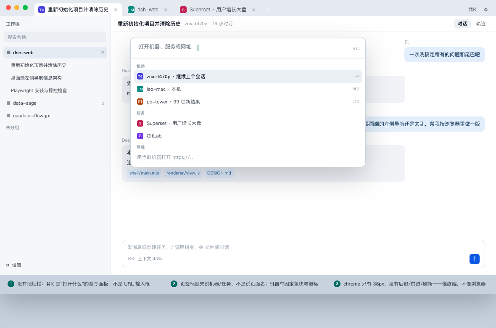
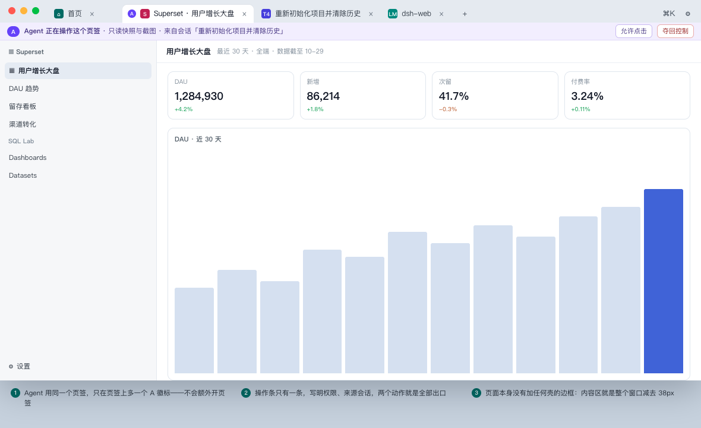

# 桌面端重构方案（定稿）

2026-10-30 · 取代 [v1 走查](left-navigation-review-2026-10-30.md) 的终态与 [v2 形态草案](intranet-browser-design-2026-10-30.md)。

**配套文档**：界面与交互规格见 [产品设计方案](desktop-product-design-spec-2026-10-30.md)；多标签实测见 [负载测试](multi-tab-load-test-2026-10-30.md)；v1/v2 是过程稿，只作推理留底。v1 的现状盘点与冲突编号仍然有效（那是问题清单），本文是收敛后的唯一施工依据。

---

## 0. 需求收敛

五轮讨论里的需求其实只有 8 条，另外 5 件是明确**不做**的。

| # | 需求 | 出处 | 验收方式 |
| --- | --- | --- | --- |
| **R1** | 左侧不再混乱：最左按钮不许功能冲突 | 第 1 轮原话 | 页签条上不再混装"视图/动作/开关/菜单"；任一时刻只有 1 个"你在这里" |
| **R2** | 顶部页签平铺（类 Chrome / mac 终端） | 第 2 轮 | 一个目标一个标签；⌘1–9 切换；⌘W 关闭；⌘⇧T 恢复 |
| **R3** | 去掉"6 台可达"这类聚合状态 | 第 2 轮 | 正常态窗口里没有任何聚合计数；断网只影响具体标签 |
| **R4** | 设置放顶部右侧 | 第 2 轮 | ⚙ 打开一个设置页（标签） |
| **R5** | 当**内网浏览器**用：不只开 DSH，别的内网 Web 服务也能开 | 第 2 轮 | NTP 服务区 + 地址栏可开目录内任意 overlay 地址 |
| **R6** | 不靠 Chrome 插件（扩展无法提供隧道），隧道留在本 app 内 | 第 3 轮结论 | app-scoped 引擎不变；`overlay-proxy` 仍是唯一出网门 |
| **R7** | DSH 能**直接操作这个浏览器**做走查 | 第 4–5 轮 | CDP 接入已实测；agent 专属标签 + 三档权限 |
| **R8** | 可维护、可回滚，不造半年后没人敢改的东西 | 全程 | 三期独立上线；tag 级回退；门禁重写而不是绕过 |

**明确不做**（写下来是为了防止范围蔓延）：

| # | 不做 | 理由 |
| --- | --- | --- |
| N1 | 通用浏览器：书签栏、扩展、下载管理器、密码、历史同步、多窗口 | 每一样都要一个维护者；这是内网入口，不是 Chrome |
| N2 | 接管系统网络（系统 VPN / 系统 resolver） | 违反 `src/app-scope.mjs` 的既有不变式，不做 |
| N3 | v1 跨机 CDP（宿主在别的机器时驱动本机浏览器） | 只能在 overlay 上开端口，等于把已登录浏览器交给所有 peer |
| N4 | 自研网络栈 | netstack + loopback proxy 已经在跑，别重造 |
| N5 | 允许 agent 操作**任意**标签 | 会和用户抢方向盘；默认只碰它自己的标签 |

---

## 1. 终态

**一句话**：这是一个**带 agent 的内网浏览器**——顶部页签是唯一导航，网络只在 app 内，agent 能在里面替你走查。

### 1.1 结构



```text
┌ 页签条 38 ────────────────────────────────────────────────────────────┐
│ ●●●  [T4 重新初始化…] [S Superset] [LM dsh-web]  ＋     ⌘K      ⚙    │
├ 内容 = 窗口 − 38 ─────────────────────────────────────────────────────┤
│                        页面自己的一切                                  │
└───────────────────────────────────────────────────────────────────────┘
```

（单行还是双行曾经是待定项；按第 9 节的定位校准，**选单行**——常驻地址栏本身就是"浏览器"的信号。）

- 没有 rail、没有机器列、没有"首页面板"。机器是**地址的一部分**，不是一列。
- chrome 从今天的 296–576px 固定导航，降到 **38px**。
- 每机器一个双字母 monogram（T4 / LM / PT）+ 稳定色，因为两台机器的 DSH 页 favicon 完全一样。

### 1.2 三张内部页

| 页 | 作用 | 图 |
| --- | --- | --- |
| **首页（服务导航）** | 默认进入；所有能打开的服务平铺（我的机器 / 内网服务两组）；点服务即开页签，已打开的直接切过去；＋ 回到这里 | [图 8](fig-8-home-services.png) |
| **设置页** | 外观 / 网络与登录（含原诊断）/ 内网服务 / 标签页 / 关于；开成一个普通标签 | — |
| **错误页** | 失败的那个页签自己变成错误页：来源 + 原因 + 一个主动作 + 错误码 + 诊断 | [图 11](fig-11-error-page.png) |

内部页有一条共同规则：**只有本机未就绪会占满窗口（NTP 顶部横幅），其余状态一律下放**（见 1.4）。

### 1.3 状态收敛：7 个整窗态 → 1 个

| 旧状态 | 现在长在哪 |
| --- | --- |
| `provisioning`（本机在准备） | **NTP 顶部横幅**（唯一需要整窗知会的状态）+ 设置页 |
| `local` / `ready` | 不需要状态，本机卡片在 NTP 里 |
| `connecting` | NTP 的"其他机器"区块一行 + 「改用本机」 |
| `login-required` / `empty` / 私网 `error` | 同上，NTP 区块；已打开的标签不受影响 |
| 某台机器连不上 | **该标签的错误页** |
| 旧的首页面板 | 删除，NTP 取代 |

### 1.4 Agent 直接操作（R7）



实测已通过（Electron 44.9 / Chromium 152 + `WebContentsView` + `--remote-debugging-port` + Playwright `connectOverCDP`）：能读 DOM、能点击、能截图；**唯一做不到的是通过 CDP 新建标签**（`Target.createTarget: Not supported`）。

因此设计成：

| 档 | agent 能做什么 | 触发 |
| --- | --- | --- |
| **只读**（默认） | 对 agent 标签取快照 / 截图 / 读 DOM | 走查 |
| **可写** | 只读 + 点击 + 输入，仍限它自己的标签 | 用户点「允许点击」 |
| **接管** | 操作你正在看的那个标签 | 显式确认，事后一键夺回 |

四条硬约束（任何一条都不能省）：

1. **标签由壳来开。** CDP 不能创建 target，所以壳提供"给 agent 开一个标签"的入口（NTP 卡片动作 / 当前标签右键）；agent 只能操作已存在的标签。
2. **同机才行。** `cdpEndpoint` 是 DSH 宿主主动拨的地址，宿主在另一台机器时 loopback 拨不到。跨机是二期：壳反向连宿主 + 宿主侧本地 CDP 适配器。
3. **端口是本地特权。** 只绑回环、随机端口、只在 agent 会话期间开、界面有醒目操作条、一键可断。
4. **审批更严。** 现有 cdp 模式 `approvalPolicy: never` 的前提是"用户自己的浏览器、用户在场"；借壳后至少 `mutations`。

白拿的三个好处：agent 的标签本身就是 live view（不用另做 screencast）；agent 走你的 overlay 和 cookie（不用二次登录）；它能到 DSH 宿主本身到不了的服务。

### 1.5 五条可检查的设计原则

| # | 原则 | 怎么验 |
| --- | --- | --- |
| P1 | 一个层级一套导航 | 屏幕上"你在这里"的标记 ≤ 2（页签 1 + 页面自己 1） |
| P2 | 位置标记只给视图 | 点任何动作后 `[aria-current]` 不变 |
| P3 | 反馈就地发生 | 任何按钮按下后 24px 邻域内有可见变化 |
| P4 | 设置只有一个家 | 窗口级设置只有一个入口（⚙） |
| P5 | 状态跟着对象走 | 任何失败状态都能定位到"哪个标签/哪台机器"，不存在无主错误 |

### 1.6 标签模型（已定）

| # | 规则 | 说明 |
| --- | --- | --- |
| L1 | **默认进首页** | 首页不是空白搜索页，是"所有能打开的服务的平铺"，按 `我的机器 / 内网服务` 分组 |
| L2 | **点服务 = 开页签** | 每个服务一个页签；服务 = 服务目录里的一条（一台机器的 DSH 是其中一条） |
| L3 | **一个服务只开一个页签** | 再点同一个服务 = 切到已有页签（并刷新）；不会出现第二个 |
| L4 | **＋ = 新建首页页签** | 和终端/VS Code 一样：新页签回到导航页，不是空白页 |
| L5 | **可关闭，且首页兜底** | × 或 ⌘W 关闭；关掉最后一个页签时回到首页，不关窗口 |

三条由我定的边界（要改就说）：

- **同一服务的不同路径也只开一个页签**（例如 Superset 的两个 dashboard）。理由：单窗口本来无法并排；页面内导航足够。若将来做分栏，这条要重估。
- **agent 不另开页签**：它操作的是同一个服务页签，只是多一条操作条（见 1.4）。这样"一个服务一个页签"对人和 agent 都成立。
- **离线/需登录的服务照常显示、照常可点**：卡片上给一行小字，点进去是错误页或登录页。**不做聚合计数**（R3）。

---

## 2. 现状（实测，不是估计）

### 2.1 宽度账

| 项 | 今天 | 改后 |
| --- | --- | --- |
| 常驻导航 | rail 48 + 机器列 248 = **296**，加上机器页面自带 280 = **576** | 页签条 **38**（单行，无地址栏） |
| 720 最小窗口的内容宽 | **144**（80% 是导航） | **682** |
| 1000 默认窗口的内容宽 | 424 | 962 |

（`.split` 固定 `48px 248px 1fr`，全文件只有一条 `prefers-reduced-motion` 媒体查询；机器页面侧栏实测 280px 且不随视口折叠。）

### 2.2 网络层已经就位——这是方案成立的前提

| 事实 | 位置 |
| --- | --- |
| 唯一出网门是 loopback 代理：按引擎 peer 表解析、不走系统 resolver、**未知 host 一律 403** | [overlay-proxy.mjs](../src/overlay-proxy.mjs:93) |
| 整个 `persist:anywhere-shell` 分区指向它（loopback 绕过） | [main.mjs](../shell/main.mjs:510) |
| 引擎是 app-scoped userspace netstack，"不接管系统"是运行时不变式 | [app-scope.mjs](../src/app-scope.mjs:1) |
| 工作区本来就是 `WebContentsView`，已在 `Map<host, view>` 里缓存 | [main.mjs](../shell/main.mjs:1281) |

**一处硬限制**：resolver 只认 `dsh.<machine>.<zone>` 且强制 80 端口（[netbird-status.mjs](../src/netbird-status.mjs:128)），所以"开别的服务"是把一种名字扩成一张表，**不是**放开 URL。由此得出产品边界：**它是 overlay 浏览器，不是内网浏览器**——纯 LAN 上的服务打不开。

### 2.3 Agent 接入实测

| 验证 | 结果 |
| --- | --- |
| `/json/list` 里能否看到 `WebContentsView` | 能，带 `browserContextId` |
| Playwright `connectOverCDP` | 能，`contexts()=1`，`pages()` 同时含窗口页与 view 页 |
| 读 DOM / 点击 / 截图 | 全部成功 |
| `context.newPage()` | **失败：`Target.createTarget: Not supported`** |

### 2.4 多标签实测（T0 前置验证，详见 [多标签负载实测](multi-tab-load-test-2026-10-30.md)）

| 指标 | 实测 |
| --- | --- |
| 每标签常驻内存 | **154–232MB**（4 个标签 ≈ 0.8–1.1GB） |
| 首屏就绪 | 2.5–3.2s，开第 4 个也不劣化 |
| 空闲 CPU | 4 个标签合计 ~0.3% |
| 隐藏后的内存 | 会被 Chromium 回收（4 个标签隐藏后 renderer 合计 428MB → 220MB） |
| 服务端连接 | 每标签 +4~5 条；`/` 的 TTFB 仍 2–7ms |
| **同一个 DSH 主机的可用标签数** | 4 个。第 5 个静默退化成空的「选择工作区」，点工作区也进不去（三轮复现） |

注意这不是一条产品限制：**同一台机器本来就不需要多个标签**（DSH 页内自带会话树与面板切换）。它的意义只有一条——壳必须对同 host 去重，否则用户双击/⌘点击就会拿到一个坏标签。

### 2.5 组件与门禁现状

- 已可复用：`overlay-proxy`、netbird 状态解析、`endpoint`（频道文档）、`notify`（未读数据源）、`WebContentsView` 缓存、`did-fail-load` 钩子、`poc/electron-shell.mjs`。
- 不要复用：`view-freshness`（它的语义是"机器视图被孤立"，标签是"页面在后台"，判定条件不同）。
- 需要重写：`renderer/view.js`（660 行状态机 + 机器列表 + rail + 首页）、`poc/shell-states.mjs` 七态断言、`test/view.test.mjs` 的 rail 断言、`DESIGN.md` 第六/七/十/十四节。

---

## 3. Gap

| # | 现状 | 终态 | 差距 | 方案 | 优先级 |
| --- | --- | --- | --- | --- | --- |
| G1 | rail 混装四种控件，在机器里亮着「新会话」 | 页签是唯一导航 | 控件语义与容器错配 | 删 rail；页签承担视图，动作回到它发生的地方 | **T0** |
| G2 | 三列固定、无断点、内容最窄 144px | 38px chrome + 内容铺满 | 宽度没有预算 | 单行页签条；标签收缩 + 溢出滚动 | **T0** |
| G3 | 首页是空屏，与列表重复 | NTP 有内容有入口 | 多一屏 | 首页面板删除，NTP 取代 | **T0** |
| G4 | 7 个整窗状态、状态重复三处 | 只剩"本机未就绪"占窗 | 状态无主 | 状态下放到 NTP 区块 / 标签错误页 | **T0** |
| G5 | 设置散落 4 处、诊断双入口 | 一个设置标签 | 无容器 | ⚙ → 设置页（含诊断与复制） | **T0** |
| G6 | 一个 view/机器，无法多开 | 一标签一 view；**同 host 只留一个标签**（产品规则：页内已能切会话） | 生命周期是机器的 | `tabViews: Map<tabId>` + 开/切/关/恢复 + `tabs.json` + 同 host 去重 | **T0** |
| G7 | 只能开 `dsh.*`，80 端口 | 目录内任意 overlay 地址 | resolver 只认一种名字 | resolver 扩成 `{服务 → peer+port}` 表 + `fleet.json services[]` | **T1** |
| G8 | 失败只有一行 notice | 整页错误页 | 错误不可读 | `did-fail-load` → 错误页（图 5） | **T1** |
| G9 | 无 agent 通道 | 三档权限 + 操作条 | 没有受控入口 | 回环 CDP 端口（会话期开）+ 开标签 IPC + 审批 | **T1**（只读）/ **T2**（可写·接管） |
| G10 | 页面里的 `window.open` 行为未定义 | 一律开成新标签 | 缺转译 | `setWindowOpenHandler` + `will-navigate` allowlist | **T1** |

---

## 4. 迭代

### T0 · 骨架（3 天）— 进行中（2026-10-30 已落第一批）

**已完成**：
- `src/tabs.mjs`：页签模型（首页唯一、服务唯一、关闭后取右邻、最后一个回首页、序列化/恢复），`test/tabs.test.mjs` 12 条断言全绿。
- 渲染层重写：`shell/renderer/{index.html,style.css,app.js}` —— 单行 38px 页签条、首页（服务平铺 + 搜索 + 已打开标记 + 未读）、设置页（五个分组 + 唯一一处复制诊断）、错误页、三态横幅、⌘K 服务面板；640/1200 两档已真渲染验证（无横向溢出）。
- 主进程接线：`tabsState` + `tabsPayload`、`tabs:open-service|open-home|open-settings|activate|close|reload|reorder`、`tabs.json` 持久化与首启恢复、关闭最后一个页签后销毁无人引用的视图、快照携带 `tabs+services`。
- 门禁：`node --test test/*.test.mjs` 214/215 通过；唯一失败是 `make-dmg`（`hdiutil` 在本会话被沙箱拒绝，与本改动无关）。
- **门禁迁移进度（2026-10-30 晚）**：
  - `poc/shell-states.mjs` 已恢复「多态 × 双色」：`ready / empty / offline / login-required / provisioning` × 浅/深，每态一张截图（`poc/evidence/state-<state>-<scheme>.png`），断言含「断网时卡片不消失」「空机队时首页为空」「需要登录时给出登录入口」。
  - `poc/local-first-run.mjs` 已迁到页签形态并**真机跑通**：本机一台、无账号、未自动开工作区、徽标数 = 宿主自报数（实测 5）、首次读取是基线不是新闻（水位 31）、点卡片开出第二个页签且 workspace seam 有 host、设置页带诊断。
  - `poc/fleet-run.mjs` 已迁移并**真机跑通**（`--netbird` 走本机引擎）：实测 17 台可达 → 17 张卡片、无横幅、无聚合文案、点另一台机器开出第二个页签且 `workspace.host` 与卡片一致（`dsh.android-192-23.netbird`）。
  - ⌘1–9 键盘模型已进断言：逐位验证「⌘N 选中第 N 个页签」；无对应页签时按 ⌘9 不变（静默跳转比不响应更糟）。
  - `poc/packaged-ui.mjs` 已在真产物上跑通：`ELECTRON_DIST=/tmp/electron-extract/Electron.app bash scripts/package-mac.sh` 产出 `Anywhere Work.app`（ad-hoc 签名、Gatekeeper 拒绝属预期），随后断言 bundle 版本/构建号、页签壳、本机卡片与角标、徽标=宿主自报、打开工作区页签、设置页版本——**全部通过**。
  - `poc/endpoint-run.mjs` 已收敛为**无人工可跑**的部分并跑通：连接入口在设置里、进入“需要登录”、横幅给出登录动作、地址字段可就地拒绝不合规值；**SSO 完成需要人**，这一半交给 `poc/fleet-sso.mjs`，不再假装能断言。
  - `poc/fleet-sso.mjs --issue-only` 跑通：app 自链路进入 `login-required` 并签发指向 `netbird.zhangchengxiang.com` 的 hand-off；完成登录仍需人（`--open`）。
  - **打包与安装已在 macOS 上端到端验完**（2026-10-30 夜）：`package-mac.sh --dmg` 产出 `Anywhere Work-0.4.10-16.dmg`（144M），`hdiutil attach` 后卷内为 app + `/Applications` 快捷方式 + 中英安装说明 + 背景；`ditto` 装到 `/Applications` 后 `codesign --verify --deep --strict` 通过；对**已安装**的 app 跑 `poc/packaged-ui.mjs` 17 条断言全绿；`open -a "Anywhere Work"` 走 LaunchServices 启动成功；经 CDP 连上已安装实例读到：单页签「首页」、无横幅、「DSH 工作区 1 个」、卡片 `leodemacbook-pro` + 「本机」角标、点卡片开出第二个页签且目标列表里出现 `DeepSeek Harness | http://127.0.0.1:3080/`；`make-dmg.test.mjs` 亦为绿（3/3）。
  - 仅剩一件环境项：Windows 真机（本机是 macOS）。
- **用户走查已完成**（`node poc/user-walkthrough.mjs`，真窗口 + 真页面）：首启 → 开本机 DSH（页面真的加载了 `http://127.0.0.1:3080/`）→ 回首页开内网服务 → 键盘切页签 → 拖拽排序 → ⌘K 面板 → 设置五个分组 → 打不开的服务落错误页 → 关到最后回首页 → 640 窄窗无溢出。截图与原生页面截图在 `poc/evidence/walkthrough/`。
- **首页分组按"这是什么"命名**（2026-10-30 晚，两轮反馈后定稿）：分组为「DSH 工作区」与「内网系统」，两者互相独立、不靠"其他"定义；计数都用「个」；当前这台电脑只加「本机」角标；卡片副标题是服务地址；跟随文案一并改（空态「还没有别的工作区」、底部「点卡片即开页签」、副标题「每张卡片开一个页签」）。三条门禁（`shell-states` / `local-first-run` / `fleet-run`）已按新结构更新并复跑通过。
- **走查中发现并修掉的三处**：① ⌘K 面板原来像浮在内容上的下拉（无遮罩、位置漂移）→ 改为居中模态 + 遮罩，点遮罩可关；② 错误页直接显示 Chromium 的英文原文（`ERR_UNSAFE_PORT (-312) loading ...`）→ 改为中文句子 + 一行小号错误码；③ 页签只能看不能排 → 补拖拽排序（`tabs:reorder` 落库）。
- **真窗口验收已通过**：`node poc/shell-states.mjs` 在真实 Electron 里跑 18 条断言全绿，包括「点卡片只开一个页签」「同一服务再点不新增」「关掉最后一个页签回首页且窗口还在」「原生页面确实挂载并加载成功」「关闭后视图解除挂载」「640 无横向溢出」「本机未就绪横幅带动作」。

**未完成（下一步）**：
- 服务目录（`fleet.json services[]`）与 web 服务页签属于 T1，本次 web 服务打开会落到「还不能在窗口里打开」的错误页。
- 页签拖拽重排的 IPC 已通，但界面还没接（T2）。

**原计划**：

页签条 + **首页（服务平铺）** + 标签生命周期（开/切/关/存/恢复）+ 服务唯一性 + 首页兜底；只支持 `dsh` 目标；删 rail、机器列、旧首页面板；本机未就绪 → 首页横幅；设置页。

**页签规则（由实测倒推，必须一起进 T0）**：

1. 同一台机器只留一个标签：再点同一台机器 = 切到那个标签。理由不是"服务端只允许 4 个"，而是**页内已经能切会话，第二个标签没有用**；顺带避免撞上实测到的第 5 个标签静默失效。
2. 不同机器/服务可并行（这才是页签的价值）；同窗口活跃标签软上限 6（≈1GB），超过提示关闭。
3. 后台标签超过 10 分钟销毁 view、保留标签与 URL；点回来重载。

**验收**（全部可机器检查）：
- `poc/shell-states.mjs` 改成三场景（首启 NTP / 开一台机器 / 关闭回 NTP）；断言页签数 = 打开数、当前标签与内容一一对应、⌘1–9、⌘W 后回到相邻标签、重启恢复上次标签。
- `poc/local-first-run.mjs` 断言首屏是 NTP、本机卡片存在、无残留 rail 元素。
- **唯一性**：连点同一台机器两次，断言页签数仍是 1、且是激活态（同一 URL = 同一个页签）。
- **首页兜底**：关掉最后一个页签，断言窗口没关、首页页签回来了。
- **＋ 是首页**：点 ＋ 断言新页签是首页，不是空白页。
- `test/view.test.mjs` 的 rail 断言替换为 tabs 模型断言。
- 七态截图重拍（现在是三场景 × 深浅两色）。

**回滚**：单期可整体回退到上一版安装包（tag）；无数据/协议变更。

### T1 · 浏览器化 + agent 只读（4 天）

服务目录 + resolver 扩展 + 错误页 + 页面菜单 + 外部链接策略 + `window.open` 转标签 + 快捷键全集 + 受控 CDP 端口（只读档）。

**验收**：
- `poc/fleet-run.mjs`：两台机器各一标签 + 一个服务标签；断开私网后点某个标签 → 错误页（页面含来源与错误码）；输入公网 URL → 断言不经本窗口加载。
- 服务目录：`fleet.json` 增加 `services[]` 后 NTP 出现该服务；旧字段结构不被破坏（未知字段忽略）。
- agent：同机 DSH 会话用 `cdpEndpoint` 连上壳，读到 agent 标签的 DOM 并截图；断言 agent **无法**通过 CDP 新建标签（这条要写成回归测试，见 G9）。

### T2 · 打磨 + agent 可写（3 天）

三档权限与操作条、审批、标签拖拽排序、溢出菜单、休眠与恢复、Windows 自定义 titlebar、POC 三端截图重拍、`DESIGN.md` 重写。

**验收**：休眠断言（后台 10 分钟后 view 销毁、标签在、点回来重载成功）；夺回控制后 agent 的下一个动作被拒；Windows 真机截图。

**合计 10 天**，其中测试与 POC 重写约 1.5 天。

---

## 5. 组件选型结论

| 组件 | 用 / 不用 | 理由 |
| --- | --- | --- |
| Electron + `WebContentsView` | **用** | `BrowserView` 已废弃、`<webview>` 官方不推荐；这是唯一未弃用的多视图原语，独立进程/历史/缩放现成 |
| `persist:anywhere-shell` 分区 | **用** | 登录态跨标签共享；不同机器是不同 host，cookie 天然隔离 |
| netstack + `overlay-proxy` | **用（唯一出网门）** | 已经是"浏览器级"网络层；未知 host 403 就是我们的 allowlist，不用新造安全模型 |
| `fleet.json` 的 `services[]` | **用** | 桌面端本来就读这份频道文档，mobile 同源；但要当不可信文档处理（schema 校验 + 旧客户端忽略未知字段） |
| `playwright-sessions` 的 `cdp` 模式 | **用** | 实测可接，DSH 侧零改动；只差一个 `cdpEndpoint` |
| `notify` feed | **用（换消费端）** | 数据源不动，展示从"机器行"变成"NTP 卡片 + 可选标签点" |
| `view-freshness` | **不复用** | 判定语义不同，硬套会假重载 |
| 自研 DNS / 自研网络栈 | **不做** | netstack 无 DNS 这件事用"表"解决，比造 DNS 便宜 |
| 通用浏览器能力（书签/扩展/下载/密码） | **不做** | 见 N1 |
| 跨机 CDP | **二期** | 见 N3 |

---

## 6. 风险台账

| 风险 | 影响 | 处理 |
| --- | --- | --- |
| **多标签 = 多份 SPA 内存** | 实测每标签 ~170MB，跨 host 并行是主要成本 | 按 170MB/标签设软上限（6 个 ≈ 1GB）+ 后台丢弃；跨 host 并行未测但不共享服务端，风险低 |
| 隧道与窗口耦合 | 引擎挂 → 所有标签同时断 | 保证隧道断开时每个标签独立进错误页，不出现整窗白屏 |
| CDP 端口是本地特权 | 本地进程可读走全部内网登录态 | 只回环 + 随机端口 + 会话期 + 显式开关 + 操作条 + 一键断 |
| 跨机场景是常态 | 你的日常是壳在本机、DSH 在远端，v1 的 agent 能力用不上 | 明确告知；跨机走二期（反向通道）或降级到 cookie 导入 |
| 身份歧义（6 台机器同款页面） | 用户不知道自己在哪台机器 | monogram + 标签左缘色条 + 地址栏机器名 chip |
| Windows 自定义 titlebar | 拖拽区/双击最大化/窗口按钮避让 | 单独一轮真机验收；来不及先保留原生 frame |
| **方向本身的风险** | 若未来上 ZTNA 网关（人不用装客户端就能进内网），这个壳的价值退化为"入口 + 徽标 + agent 面" | 届时应重新评估是否继续维护；这需要业务判断，不是技术判断 |

---

## 7. 需要你拍板的三件事

1. **单行 chrome（无地址栏、⌘K 命令面板）是否确认？** 这是第 9 节定位校准的结论：常驻地址栏会让它看起来就是浏览器。代价是"随便输个网址"要按 ⌘K。
1b. **首页页签是否允许关闭**（关闭后靠 ＋ 或"关最后一个回首页"找回），还是做成不可关闭的固定页签？我倾向可关闭 + 兜底。
2. **公网 URL 默认外跳系统浏览器**，还是允许内开（加"在本窗口打开"的二级动作）？
3. **agent 默认档**：只读（最安全，走查看得多）/ 可写但仅限它的标签（我倾向这个）。接管当前标签一律需要显式确认，不设默认。

这三条定了，T0 就可以开工。

---

## 8. 还没解决的问题

方案本身收敛了（§1–§7 的决策不再摇），但下面这些还没答案。按"会不会推翻方案"排序。

### 8.1 会推翻或大幅改写的（3 个，建议现在定）

| # | 问题 | 为什么致命 | 兜底 |
| --- | --- | --- | --- |
| **Q1** | **agent 操作只在同机可用**，而你的常态是壳在本机、DSH 在远端 | R7（走查）在最常见拓扑下直接用不了；如果这是核心卖点，v1 交付即打折 | ① v1 只承诺同机；② 二期做反向通道（壳连宿主 + 宿主侧本地 CDP 适配器）；③ 降级到 cookie 导入 |
| **Q2** | **一个页面可能跨多个 origin** | **结论修正（2026-10-30 晚）**：403 是**验收用 JS 代理**（`src/overlay-proxy.mjs`）的策略，**不是产品行为**。产品用的 `portalbind`（`client/portalbind/portal.go`）不做名字过滤，直接把 `Host`/CONNECT 地址交给 `client.Dial` 走 NetBird，所以 **NetBird DNS 能解析的名字本来就能开**。真正缺的是"列出服务 + 用页签加载它"，已补（见 T0 进度） | 剩下的只是跨 origin 的真实性：一个页面若引用第二个 origin，只要那个名字也在 NetBird DNS 里就成立；否则仍然缺资源（与浏览器行为一致） |
| **Q3** | **内存预算**：每标签 ~170MB，本机 swap 已用 7.2/8GB | 8GB 机器上 4 个标签就会明显卡；"多开"是这个形态的核心体验 | 软上限 6 → 按内存压力动态降到 3；后台 10 分钟丢弃 |

### 8.2 会改工期的（4 个，T1 前必须有答案）

| # | 问题 | 现状 |
| --- | --- | --- |
| Q4 | **https 服务**能否走通 | **已实测通过**（`poc/proxy-origins.mjs`）：CONNECT 建立隧道、字节双向可达、overlay 外的名字仍 403。剩下的只是把 resolver 映射到 443 并让页面走 https |
| Q5 | **`@playwright/mcp` 在 cdp 模式下会不会一启动就 `newPage`** | 实测 CDP 侧 `Target.createTarget` 不支持。若 MCP 启动即建页，agent 会话根本起不来 → 必须让壳先开好标签，再把 endpoint 给 MCP |
| Q6 | **服务目录的 schema 与兼容性** | `fleet.json` 加 `services[]` 后，旧桌面端/旧手机端会不会崩；目录里要不要带"该服务依赖哪些 origin"（Q2 的输入） |
| Q7 | **页面快捷键冲突** | 页内已有 ⌥⌘N 等；壳的 ⌘1–9 / ⌘W / ⌘L 在输入框聚焦时的优先级未定 |

### 8.3 待定但不阻塞的（可以带病上线）

| # | 问题 |
| --- | --- |
| Q8 | Windows 自定义 titlebar（拖拽区、双击最大化、窗口按钮避让）——第一版可以保留原生 frame |
| Q9 | 跨 host 多标签没实测（只测了同 host；不同 host 不共享服务端，风险低） |
| Q10 | `tabs.json` 的损坏回退与多窗口共存 |
| Q11 | 休眠/丢弃后切回是否保留滚动位置（Chrome 会丢，用户接受度未知） |
| Q12 | DSH 页在 1000px 宽标签里的自身可用性（它自带 280px 侧栏）——可能需要把默认窗口提到 1200，或让 DSH 侧做窄屏适配（属另一个仓库） |
| Q13 | 门禁重写本身要用户认账：`poc/shell-states.mjs` 七态断言会被替换，这是"验收依据"的变更，不是普通测试改动 |

### 8.4 一句话总结

**能开工的部分**：T0（页签 + NTP + 生命周期 + 删三列）。
**不能开工的部分**：T1 的"任意内网服务"卡在 Q2/Q4，R7 的跨机卡在 Q1。
**建议顺序**：先花半天把 Q2 和 Q4 各做一个最小实验（一个带多 origin 的静态页 + 一个 https 内部服务），它们的结果决定 T1 是"浏览器"还是"DSH 多标签壳"。

---

## 9. 定位校准：它是工作台，不是浏览器

你的质疑是对的，而且我上一版把它推向了浏览器——**推荐"双行 chrome + 常驻地址栏"是个错误**。那一版所有细节都在强化"这是浏览器"：地址栏、后退/前进/刷新、写着"打开什么？"的新标签页、以页面名命名的标签。

### 9.1 它会在哪三个地方变成"浏览器"

| 机制 | 表现 | 后果 |
| --- | --- | --- |
| **常驻地址栏 + 内网 chip** | 用户开始往里输 URL，期待书签、历史、自动补全 | 用浏览器的尺子量我们，我们必输（没有扩展、没有密码、没有下载、没有同步） |
| **"新标签页"里放搜索框** | 它就是 Chrome NTP 的翻版，只是把书签换成了机器 | "我的机器"被降级成"快捷方式"，anywhere 的叙事消失 |
| **标签标题 = 页面标题** | 屏幕上全是 Superset / GitLab / DeepSeek Harness | 看不出"我在哪台机器上干活"，而这正是产品的全部差异 |

### 9.2 换一个锚点：你原话里的第一个比喻

你说的是"类似 **mac 的终端** 或者 chrome 浏览器的页签"。这两个比喻里，**终端才是对的**，Chrome 只是提供了"页签"这个容器 idiom。

- 终端：一条标签条 + 内容，没有地址栏，靠命令和上下文工作。
- Chrome：标签条 + 地址栏 + 一堆浏览器语义。

页签本身不是浏览器身份（Xcode、VS Code、Terminal、Slack 都有页签）。**让它变成浏览器的是那一行地址栏。**

### 9.3 修正后的形态


| 去掉 | 换成 |
| --- | --- |
| 常驻地址栏 | **⌘K 命令面板**（机器 / 服务 / 网址三类结果，可键盘操作）。它是"打开什么"，不是"输入 URL" |
| 后退 / 前进 / 刷新 按钮 | ⌘[ ⌘] ⌘R，以及页面自己的导航 |
| "打开什么？"的 NTP | **"今天在哪台机器上干活？"**：机器在第一屏，服务折叠在下面 |
| 页面标题当标签名 | **机器名 + 任务**：`T4 重新初始化项目并清除历史`；服务标签退为次要（灰） |

chrome 从 80px 变 **38px**，内容再拿回 42px。

### 9.4 三条可检查的身份约束

| # | 约束 | 检查方法 |
| --- | --- | --- |
| I1 | **机器永远比页面先出现** | 任意一屏，机器名/色块的出现位置都不晚于页面名 |
| I2 | **没有常驻的 URL 输入** | 截图里不出现地址栏；"打开网址"只在 ⌘K 里 |
| I3 | **没有浏览器承诺** | 不出现书签栏、历史、扩展、下载、密码；帮助文档里也不提 |

### 9.5 三个自检问题（每次改版都问）

1. **把截图给一个没用过的人，他会说这是浏览器还是工作台？**
2. **把所有服务都拿掉，只剩机器，它还成立吗？**（成立 = 它是机器工作台；不成立 = 它只是浏览器的壳）
3. **它能不能回答"这台机器现在在干什么"？** 浏览器回答不了，这是我们的本分。

### 9.6 反向意见（诚实写下来）

如果哪天"随便打开任意内网服务"权重高于"进入我的机器"，那双行 + 地址栏确实更顺手——**但那就得承认它是个浏览器**，并按浏览器的标准维护（书签、历史、下载、多窗口）。这两条路不能都要。我的建议是：**先做工作台**，服务是"从机器出发能到的地方"，不是"浏览器能打开的一切"。

