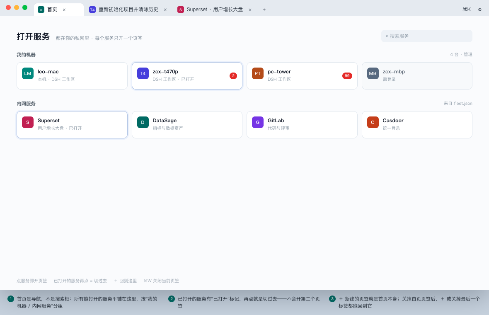
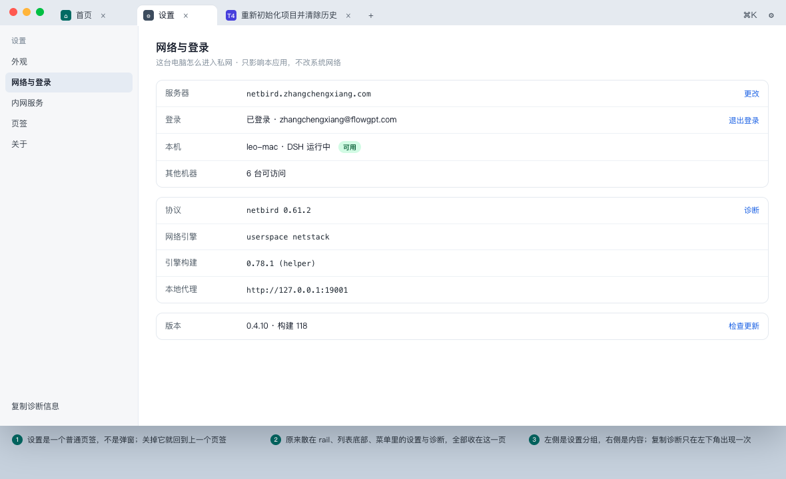
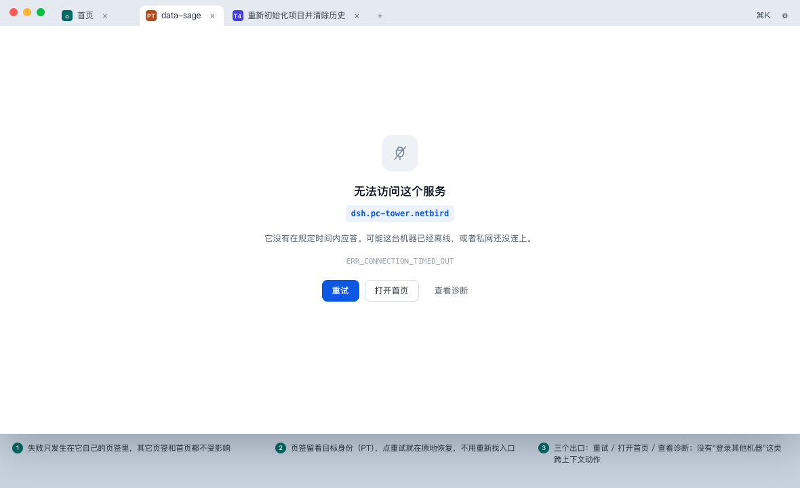

# 桌面端产品设计方案 v1.0

2026-10-30 · 施工用的界面与交互规格。决策背景与分期见 [定稿方案](desktop-intranet-browser-plan-2026-10-30.md)，实测数据见 [负载测试](multi-tab-load-test-2026-10-30.md)；本文只回答"长什么样、怎么动、什么时候说什么话"。

**图**：[8 首页](fig-8-home-services.png) · [9 服务页 + Agent](fig-9-service-page-agent.png) · [10 设置](fig-10-settings.png) · [11 错误页](fig-11-error-page.png) · [7 单行形态与 ⌘K](fig-7-workbench-not-browser.png)

---

## 1. 产品定义

### 1.1 一句话

**一台可以随身进入的机器工作台**：打开它，看到你能进的所有服务（首先是你自己的机器），点一下就进去干活。

### 1.2 三个典型任务

| 任务 | 今天要几步 | 目标态 |
| --- | --- | --- |
| 回到某台机器上没做完的活 | 打开客户端 → 找机器 → 点开 → 等页面加载 → 找会话 | 打开客户端就恢复上次的页签，或点首页卡片一次 |
| 看一眼另一台机器的结果 | 同上，且会丢当前上下文 | 点首页卡片，回来时上一页签还在 |
| 让 agent 替我在某个内网系统里走查一遍 | 做不到（agent 的浏览器没有登录态） | 在首页让 Agent 用这个服务，看着它点 |

### 1.3 不做什么（产品红线）

- 不做书签栏、历史、扩展、下载管理器、密码管理、多窗口。
- 不接管系统网络（不装系统 VPN、不改系统 DNS）。私网只在本应用内生效。
- 不承诺"浏览器能打开的一切"。能打开的只有私网 overlay 里登记过的服务。

### 1.4 与 DSH 的关系

DSH 是**一个服务**，和 Superset、GitLab 平级。壳不重排 DSH 的页面，只给它一块完整的矩形。

---

## 2. 信息架构

### 2.1 对象模型

```text
服务目录（fleet.json services[] + 每台机器自带的 DSH）
 ├── 机器服务 kind=machine   一台机器 = 一个 DSH 工作区入口
 └── 内网服务 kind=web       其他 Web 系统（Superset / GitLab / …）

窗口
 └── 页签（最多一个首页 + N 个服务）
      ├── 首页页签  kind=home     服务导航
      └── 服务页签  kind=service  一个服务一个，不可重复
```

### 2.2 三层，不再有第四层

| 层 | 谁负责 | 承载 |
| --- | --- | --- |
| 窗口 | 壳 | 页签条、页签生命周期、全局态（只有"本机未就绪"） |
| 页签 | 壳 | 一个服务的一份实例（`WebContentsView`） |
| 页面 | 服务自己 | 它内部的一切（DSH 的侧栏、面板、终端；Superset 的看板） |

**壳不进入页面内部**。页面里没有壳的按钮、边框、状态条。

### 2.3 术语表

| 词 | 含义 | 不要用 |
| --- | --- | --- |
| **首页** | 服务导航页，一个可关闭的页签 | 新标签页、开始页、NTP |
| **服务** | 目录里的一条可打开目标 | 站点、应用、入口 |
| **机器** | kind=machine 的服务，本质是某台电脑的 DSH | 节点、peer、主机 |
| **页签** | 一个服务的实例 | 标签页、Tab（UI 文案里） |
| **私网** | 本应用内的 overlay | VPN、隧道 |

---

## 3. 窗口与布局

### 3.1 解剖

```text
┌ 页签条 38px ─────────────────────────────────────────────────────┐
│ ●●●  [首页] [T4 …] [S Superset]  ＋              ⌘K    设置       │
├ 内容 = 窗口高 − 38px ────────────────────────────────────────────┤
│                        页面自己的一切                             │
└─────────────────────────────────────────────────────────────────┘
```

只有一个常驻 chrome 行。**没有地址栏、没有后退/前进/刷新按钮、没有状态条。**

### 3.2 尺寸

| 项 | 值 |
| --- | --- |
| 默认窗口 | 1200 × 800 |
| 最小窗口 | 640 × 480 |
| 页签条 | 38px |
| 内容 | 窗口 − 38px，无内边距 |
| macOS 红绿灯 | 左侧内衬 78px，页签从 x=78 开始 |
| Windows | 页签条兼作 titlebar，右侧预留 138px 给窗口按钮；设置 放在 138px 安全区内 |

### 3.3 页签条规格

| 元素 | 规格 |
| --- | --- |
| 页签 | 高 30，圆角 8（顶部圆角，底部与内容相连），左右内边距 9/8，最小宽 96，最大 230 |
| 页签内容 | 机器/服务色块 16 + 标题（12px，单行省略）+ 关闭 16 |
| 激活态 | 白底（与非激活的灰条对比）+ 标题 600 字重；**不用下划线、不用彩色描边** |
| 关闭按钮 | 仅激活或悬停时出现（16×16，命中区 22） |
| ＋ | 28×28，紧跟在最后一个页签后 |
| 溢出 | 页签总宽超出时先压缩到 96，再横向滚动（隐藏滚动条，滚轮/触控板可滚） |
| 右侧 | `⌘K` 提示（10.5px，仅宽窗显示）与 `设置`，各 28×28 |
| 拖拽 | 页签可拖动重排；空白区拖动窗口 |

---

## 4. 页面设计

### 4.1 首页（服务导航）



**结构**

```text
打开服务   都在你的私网里 · 每个服务只开一个页签        [搜索服务]
我的机器   [卡片×4 网格]
内网服务   [卡片×4 网格]
──────────────────────────────────────────────
点服务即开页签 · 已打开的服务再点 = 切过去 · ＋ 回到这里
```

| 项 | 规格 |
| --- | --- |
| 页内边距 | 上 34 / 左右 40 |
| 标题 | 「打开服务」20px/600；副标题 11.5px 次要色 |
| 搜索 | 220×30 圆角 8，占位「搜索服务」；输入即过滤卡片（不区分机器/服务） |
| 分组标题 | 11.5px/600 次要色；右侧给「N 台 · 管理」这类元信息（10.5px） |
| 卡片 | 高 66，圆角 10，边框 1px，内边距 12，图标 28 + 标题 12.5/600 + 副标题 10.5 |
| 网格 | ≥1100 四列 / 900–1100 三列 / 620–900 两列 / <620 一列；间距 10 |
| 已打开 | 卡片描边变主色（1px）+ 3px 淡主色外圈；副标题末尾加「· 已打开」 |
| 未读徽标 | 右上角，红底白字，>99 显示 `99+`；只有失败才纯红，普通完成用中性色数字 |

**首页的状态**

| 状态 | 表现 |
| --- | --- |
| 加载中 | 两组骨架卡（各 4 个），标题与网格位置不跳 |
| 空 | 一句「还没有可打开的服务」+ 说明（未登录时给「登录」按钮） |
| 本机未就绪 | **顶部横幅**（见 4.5），卡片区照常显示可用的远程服务 |
| 部分失败 | 不展示全局错误；对应卡片加一行小字「离线」或「需登录」，仍可点击 |

**交互**

- 点击卡片 = 打开服务页签；已存在 = 切过去并刷新一次。
- ⌘点击 / 中键 = 同左（因为服务唯一，行为一样，不做新页签）。
- 右键 = 「在新页签打开」置灰（唯一性）、「复制地址」、「移除」（仅自定义服务）。

### 4.2 服务页


- 内容区就是服务自己的页面，壳不加任何边距、边框、标题条。
- 加载中：页面区域显示 3 行骨架（120ms 后才出现，避免闪烁）；超过 8 秒仍未就绪 → 转为错误页。
- 页内导航（前进/后退）由页面自己负责；壳不提供按钮，只把 ⌘[ / ⌘] 转发给 `webContents`。

**Agent 操作条**（只在 agent 使用该页签时出现，高 30）

```text
[A] Agent 正在操作这个页签 · 只读快照与截图 · 来自会话「重新细化方案」   [允许点击] [夺回控制]
```

| 档 | 操作条文案 | 右侧动作 |
| --- | --- | --- |
| 只读 | 「· 只读快照与截图 ·」 | 允许点击 / 夺回控制 |
| 可写 | 「· 可点击与输入 ·」 | 收窄为只读 / 夺回控制 |
| 接管 | 「· 接管了你正在看的页签 ·」 | 夺回控制（主按钮） |

- 结束操作 → 操作条消失，页签上的 A 徽标同时移除。
- 夺回后 agent 的下一个动作被拒绝，并提示「已由你接管」。

### 4.3 设置页



一个普通页签（最多一个），左侧 208px 分组、右侧内容：

| 分组 | 字段 |
| --- | --- |
| 外观 | 跟随系统 / 浅色 / 深色 |
| 网络与登录 | 服务器（可改）、登录状态（退出登录）、本机状态、其他机器（"已加入私网 · 在首页查看"）、协议、网络引擎、引擎构建、本地代理、诊断 |
| 内网服务 | 目录列表（名字 + 地址 + 是否启用）、添加自定义服务 |
| 页签 | 启动时恢复上次页签（默认开）、后台休眠时长（默认 10 分钟） |
| 关于 | 版本 + 构建号、检查更新、开源许可 |

左栏底部固定「复制诊断信息」——**整个产品只有这一处**。

### 4.4 错误页



页签留在原地，内容换成错误页。四类失败共用骨架，只换文案：

| 类别 | 标题 | 说明 | 动作 |
| --- | --- | --- | --- |
| 超时 / 离线 | 无法访问这个服务 | 它没有在规定时间内应答。可能这台机器已经离线，或者私网还没连上。 | 重试 / 打开首页 / 查看诊断 |
| 需登录 | 这个服务要登录 | 这台机器在，但它要求的身份还没通过。 | 重试 / 打开首页 |
| 本机服务未启动 | 本机的服务没起来 | 这台电脑上的 DSH 还没跑起来。 | 在终端运行安装器 / 重试 |
| 地址不存在 | 找不到这个服务 | 目录里的地址可能已经变了。 | 打开首页 / 查看诊断 |

规格：图标 54 圆角 16；标题 17/600；来源地址用等宽字体蓝色胶囊；错误码 11 等宽次要色；按钮高 32，主按钮纯色，其余描边或纯文字。

### 4.5 首启 / 本机未就绪

唯一占满窗口的状态：**首页顶部横幅**（高 44，警告底色），内容随缺什么变：

```text
注意 本机的 DSH 还没起来。在终端运行安装器后点重试。        [复制命令] [重试]
```

- 卡片区照常可用：远程机器与服务不依赖本机。
- 横幅可关闭（×），关闭后降级为首页底部一行小字，下次启动再出现。

---

## 5. 交互规格

### 5.1 打开 / 切换 / 关闭

| 场景 | 规则 |
| --- | --- |
| 点首页卡片 | 打开该服务页签；若已存在 → 切过去 + 刷新 |
| 首页存在时点 ＋ | **切到首页**（不新建第二个首页） |
| 首页不存在时点 ＋ | 新建首页页签 |
| 关闭首页页签 | 允许；若还有其他页签，切到相邻页签 |
| 关闭任何页签 | 切到右侧相邻，没有则左侧 |
| 关闭最后一个页签 | **回到首页**（自动新建），不关窗口 |
| ⌘W | 关闭当前页签（同上规则） |
| ⌘⇧W | 关闭窗口 |
| 启动 | 有上次页签 → 恢复（首页 + 服务，顺序保留）；没有 → 首页 |
| 崩溃后重启 | 恢复页签但不自动重载服务页，显示「上次未正常退出」提示条 |

### 5.2 键盘

| 键 | 行为 |
| --- | --- |
| ⌘T / ＋ | 首页（已有则切过去） |
| ⌘W | 关闭当前页签 |
| ⌘1–⌘9 | 切到第 N 个页签 |
| ⌘⇧T | 重新打开刚关掉的页签 |
| ⌘K | 打开「跳到服务」面板（可搜索并直接打开，不离开当前页签） |
| ⌘, | 设置 |
| ⌘R | 刷新当前页面 |
| ⌘[ / ⌘] | 页内后退 / 前进（转发给页面） |
| Esc | 关闭面板；若 agent 在操作 → 中断 agent 并夺回 |
| ⌘⇧F | 全屏 |

### 5.3 鼠标 / 触控板

- 页签：左键切换、中键关闭、拖动重排、右键菜单（关闭 / 关闭其他 / 关闭右侧 / 重新加载）。
- 卡片：左键打开、右键（复制地址 / 从目录移除，仅自定义服务）。
- 关闭按钮只在激活或悬停时出现；避免误关。

### 5.4 焦点与注意力

- 新开页签 → 焦点进内容区。
- agent 开始操作 → 若当前不在该页签，页签上加**脉冲点**（不自动抢焦点）；首次发生时才切过去。
- 错误页出现 → 不抢焦点，只在页签标题前加错误点。

---

## 6. 状态矩阵

### 6.1 服务卡片

| 状态 | 视觉 | 可点 |
| --- | --- | --- |
| 正常 | 白底、普通边框 | 是 |
| 已打开 | 主色描边 + 3px 淡主色外圈 + 副标题「· 已打开」 | 是（切换） |
| 需登录 | 灰底、副标题「需登录」 | 是（进登录页） |
| 离线 | 灰底、副标题「离线」 | 是（进错误页） |
| 有未读 | 右上角数字徽标 | 是 |
| 加载中（目录） | 骨架卡 | 否 |

### 6.2 页签

| 状态 | 视觉 |
| --- | --- |
| 激活 | 白底、标题 600 |
| 非激活 | 透明、灰条、标题常规 |
| 加载中 | 色块位置换成 12px 旋转环 |
| 错误 | 色块右下角 6px 红点 |
| agent | 色块前多一个 14px 紫色 A 圆点；非激活时该点呼吸 |

### 6.3 全局态

只有两个：正常、本机未就绪（横幅）。**没有"私网连接中""N 台可达"这类全局状态。**

---

## 7. 文案规范

### 7.1 词表

| 用 | 不用 |
| --- | --- |
| 打开服务 / 打开首页 | 新建标签页 / 新窗口 |
| 页签 | 标签、Tab |
| 机器 | 节点、peer、设备 |
| 私网 | VPN、内网（对外可说"内网"，UI 内统一"私网"） |
| 重试 | 再试一次、刷新 |

### 7.2 错误文案模板

`{对象} + 发生了什么 + 为什么 + 下一步`，一句一行：

> 无法访问这个服务。
> 它没有在规定时间内应答。可能这台机器已经离线，或者私网还没连上。
> `ERR_CONNECTION_TIMED_OUT`

不写"出错了""未知错误"；错误码保留原样（它是诊断线索）。

### 7.3 禁止出现

- 全局统计（"6 台可达"）、百分比进度、自述式旁白（"正在为你…"）。
- 内部术语：引擎、netstack、overlay、mux、peer。

---

## 8. 视觉规范

### 8.1 Token（沿用 `tokens.json`）

| 用途 | 值 |
| --- | --- |
| 背景 / 面板 | `#ffffff` / `#f7f8fa` |
| 分割线 | `#e8ecf1`（1px） |
| 主文字 / 次文字 / 弱文字 | `#0f172a` / `#5b6672` / `#94a3b8` |
| 主色（唯一强调） | `#2563eb` |
| 危险 | `#dc2626` |
| Agent | `#6d4aff`（只用于 agent 相关，别的场景不出现） |
| 间距 | 4 / 6 / 8 / 10 / 12 / 14 / 18 / 22 / 26 / 34 / 40 |
| 圆角 | 6 / 8 / 10 / 12 / 16 |

**服务色块**：固定 8 色（indigo `#4f46e5`、teal `#0d9488`、amber `#b45309`、rose `#be185d`、sky `#0369a1`、violet `#7c3aed`、orange `#c2410c`、slate `#475569`），按服务 id 哈希取色，同 id 稳定不跳。

### 8.2 字阶（只有 5 档）

| 档 | 字号/行高 | 字重 | 用途 |
| --- | --- | --- | --- |
| 页标题 | 20 / 28 | 600 | 首页「打开服务」 |
| 区块标题 | 16 / 22 | 600 | 设置页标题、错误页标题 |
| 正文 | 12.5 / 18 | 400/600 | 卡片标题、设置行 |
| 次要 | 11.5 / 16 | 400 | 副标题、说明、操作条 |
| 辅助 | 10.5 / 14 | 400/600 | 元信息、页签右侧提示、错误码 |

### 8.3 图标

16px 线性（1.4 描边）、圆角端点；机器/服务用 16 色块 + 双字母，不用 favicon（两台机器的 DSH 图标完全一样）。

### 8.4 暗色

沿用 `tokens.json` 的 dark 表：面板 `#12161d`、分割线 `#1f2632`、主文字 `#e9eff8`、次文字 `#a3b3c9`。服务色块在暗色下统一降到 85% 亮度，保证白字对比度 ≥ 4.5:1。

### 8.5 动效

只用两处：页签切换 120ms 淡入；操作条出现 160ms 高度展开。全部尊重 `prefers-reduced-motion`。

---

## 9. 可访问性

- 页签是 `role=tablist` / `role=tab`，`aria-selected`；关闭按钮有 `aria-label="关闭 {服务名}"`。
- 卡片是 `role=button`，可 Tab 聚焦，Enter/Space 打开；焦点环 2px 主色 + 1px 偏移。
- 未读与错误不能只靠颜色：徽标带数字，错误点带 `aria-label`。
- 所有文字/背景组合过 WCAG AA（4.5:1）。
- 内容区获得焦点时，页签条仍可用 ⌘1–9 到达。

---

## 10. 验收清单

**机器可查（POC 断言）**

1. 启动进首页；页签数 = 1（首页）。
2. 点任一卡片 → 页签 +1，内容为该服务。
3. 再点同一卡片 → 页签数不变，且该页签激活。
4. 关掉最后一个页签 → 窗口仍在、首页回来了。
5. ＋ → 首页；已有首页时不新增第二个。
6. ⌘1–9 切换与页签顺序一致。
7. 错误页出现时，页签保留目标色块与标题。
8. 首页断网时卡片仍在（不整屏报错），点进去才是错误页。
9. 全窗口截图里不存在地址栏元素（选择器断言）。
10. 全窗口截图里不存在「N 台可达」这类聚合文案（文本断言）。
11. agent 操作时该页签有 A 徽标 + 操作条存在；结束时消失。
12. 320/640/1200 三个宽度下，内容区宽度 = 窗口宽（不出现横向滚动）。

**人眼验收**

1. 截图给一个没用过的人，他说"工作台"而不是"浏览器"。
2. 首页一眼能看出"哪些是我的机器、哪些是别的系统"。
3. 页签上的机器身份（色块 + 名字）在不看内容时也能分辨。
4. 错误页给出的下一步是清楚的，不需要回到首页再找。
5. 设置页里能找到"为什么连不上"的答案。
6. 暗色下没有看不清的文字或徽标。

---

## 11. 待定

| # | 事项 | 现状 |
| --- | --- | --- |
| 1 | 首页页签是否允许关闭 | 本文按"允许 + 兜底"写；若改成固定页签，删掉 5.1 的三条规则 |
| 2 | agent 默认档 | 本文按"只读"写；若默认可写，操作条文案与审批策略随之改 |
| 3 | 启动恢复 | 本文按"恢复上次页签"写；若默认开首页，删掉 5.1 的恢复规则 |
