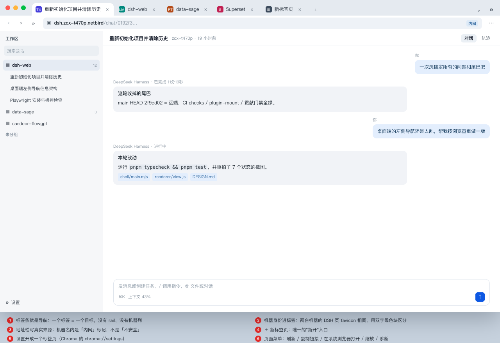
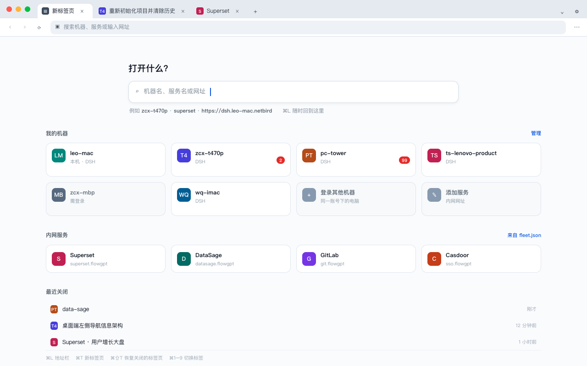
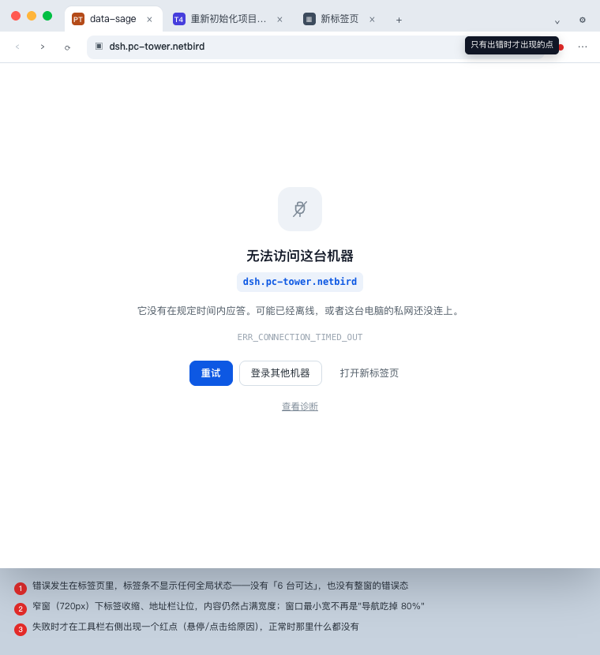

# 桌面端重新设计：把它当一个内网浏览器（草案，已被定稿取代）

> **本文是过程稿**。需求收敛、agent 操作能力、组件选型与分期已并入 [终稿方案](desktop-intranet-browser-plan-2026-10-30.md)，施工以定稿为准；本文保留作推理过程。

2026-10-30 · 第二版（取代 [第一版](left-navigation-review-2026-10-30.md) 的"终态"一节）· 范围仍只到窗口外壳

第一版回答的是"左侧为什么乱"。这一版按你的新方向重做形态：**顶部页签平铺、去掉了"6 台可达"这类全局状态、设置放顶部右侧、可以打开任意内网 Web 服务**。

一句话：**这个窗口只回答"现在打开的是哪个页面"，不再回答"我有几台机器、通到几台"。** 机器从"一列"降级成"地址的一部分"。



---

## 0. 相对第一版变了什么

| | 第一版（现状 + 修补） | 这一版 |
| --- | --- | --- |
| 导航 | rail（4 项）+ 机器列（248）+ 页面自带侧栏（280） | **只有页签条**。没有 rail、没有机器列 |
| "我在哪" | rail 上点亮的按钮（而且点亮的是"新会话"） | 当前页签 + 地址栏里的真实来源 |
| 可达性状态 | toolbar 的"已连接 · 6 台可达" + 账号条 + 诊断，三处 | **正常时一处都没有**；失败只在那个页签里 |
| 首页 | 一张空屏（首页面板） | 新标签页（有内容、有入口、可搜索） |
| 设置 | 散在 rail / 列表底部 / 菜单 | 一个设置页，开成一个页签 |
| 能开什么 | 只能开 DSH 机器 | **任意内网地址**：机器、服务、自定义 URL |
| 720 最窄窗口 | 内容 144px | 内容 = 窗口 − 80px 的 chrome |

第一版的三条原则依然成立，只是落点变了：一个层级一套导航（现在是"页签"这一层）、位置标记只给视图（页签就是视图）、设置只有一个家（设置页）。

---

## 1. 从 Chrome 借什么

借的是**结构**，不是像素。

| Chrome 的做法 | 我们怎么落 | 为什么 |
| --- | --- | --- |
| 页签条：一个标签一个页面，⌘1–⌘9 切换 | 同。标签宽度 96–230px，超出后滚动，**永远是同一行** | 标签本身就是"我在哪"的答案，不需要再有一个 rail |
| 激活标签与工具栏融合成一整块 | 同：激活页签的底色 = 工具栏底色，视觉上是一个容器 | 避免"页签是页签、内容是内容"的割裂 |
| 关闭按钮只在悬停/激活时出现 | 同 | 一行放得下更多标题 |
| 新标签页（NTP）是内容，不是状态 | 同：NTP 有搜索框 + 机器 + 服务 + 最近关闭 | 现在这张"空屏首页"就是没有内容的 NTP，所以显得多余 |
| 地址栏（omnibox）写真实来源 | 同，但用「内网」chip 代替锁头（全部是 http 内网，标"不安全"只会变成噪音） | 来源是身份：`dsh.zcx-t470p.netbird` 和 `superset.flowgpt` 一眼能分 |
| 页面菜单 ⋯ | 同，但菜单项按内网场景裁剪：刷新 / 复制链接 / 在系统浏览器打开 / 缩放 / 全屏 / 诊断 / 开发者工具 | 不放 Chrome 的"保存网页/翻译/投射" |
| chrome://settings 开成一个标签 | 同：设置是一个普通标签页（`设置`），不是弹窗 | 顶部右侧一个 ⚙，点开就是一个标签；和"浏览器"心智一致 |
| 标签级错误页（in-tab） | 同：失败的那个标签自己变成错误页 | 这样就不需要"整窗错误态"，也不需要"6 台可达" |
| 会话恢复（继续上次打开的标签页） | 同：`tabs.json`，下次启动恢复上一次的标签 | 进机器的路径变成 0 次点击 |
| 标签丢弃/休眠 | 同：后台标签 10 分钟后卸载页面但保留标签，点回来自动恢复 | 三个 DSH 标签 ≈ 三份 SPA 内存，必须能回收 |
| （不借）书签栏、扩展、下载管理器、密码、历史、同步、多窗口 | v1 全部不做 | 这是内网入口，不是通用浏览器；每多一个都要有维护者 |

**一处刻意偏离 Chrome**：Chrome 把 http 明文标成「不安全」。我们的全部服务都是内网 http，照搬会让整条工具栏常年泛红，人对红色就免疫了。所以用中性的「内网」chip，并把"公网地址一律交给系统浏览器"当成分界线（见第 6 节）。

---

## 2. 窗口解剖

```text
┌ 页签条 40px ─────────────────────────────────────────────────────────────┐
│ ●●●  [T4 重新初始化项目…] [LM dsh-web] [S Superset]  ＋      ⌄     ⚙    │  ← macOS 红绿灯在左
├ 工具栏 40px ─────────────────────────────────────────────────────────────┤
│  ‹  ›  ⟳   ▣ dsh.zcx-t470p.netbird /chat/0192f3…      [内网]    ⋯        │
├ 内容（= 页面自己，壳层不加任何边距）────────────────────────────────────┤
│                                                                          │
└──────────────────────────────────────────────────────────────────────────┘
```

| 区域 | 尺寸 | 内容 | 备注 |
| --- | --- | --- | --- |
| 页签条 | 40px | 红绿灯（mac 78px 内衬）· 标签 · ＋ · 标签列表 ⌄ · ⚙ | 兼作拖动区；双击最大化 |
| 工具栏 | 40px | 后退 / 前进 / 刷新 · 地址栏 ·（失败点）· ⋯ | 后退前进按标签各自的历史 |
| 内容 | 窗口 − 80px | 一个 `WebContentsView`，铺满 | 页面自己负责它内部的一切（DSH 的侧栏、面板都算页面） |
| chrome 合计 | **80px** | | 原来固定导航是 296–576px |

- **平台差异**：macOS 用 `hiddenInset`，标签从 x≈78 开始，红绿灯浮在页签条上；Windows 把页签条当自定义 titlebar（右侧留出最小化/最大化/关闭约 138px），所以 ⚙ 要放在窗口按钮左边的安全区内。如果第一版想省事，Windows 可以先保留原生 frame，代价是多一条系统 titlebar（80 + 32 = 112px）。
- **为什么用两行而不是 Safari 那种"页签+地址栏合一"**：单行能省 40px，但地址栏会被挤成一个小胶囊，"打开任意服务"这件事就从主入口降级成隐藏功能；这个产品的卖点是**内网入口**，地址栏必须是常驻的一等公民。
- 窗口最小宽建议从 720 降到 **560**：现在没有占宽 576px 的导航了，560 宽下页签收缩、地址栏变短，内容仍有 480px。

---

## 3. 标签模型

**一个标签 = 一个 target**，不是"一台机器"。

| 字段 | 说明 |
| --- | --- |
| `id` | 稳定 id（不是 host，允许同一台机器多个标签） |
| `kind` | `dsh` / `web` / `ntp` / `settings` |
| `url` | 规范化后的地址（机器名 → `http://dsh.<name>.<zone>/`） |
| `machine` | 仅 `dsh` 有，用于 monogram 与徽标 |
| `title` | 来自页面 `page-title-updated`，壳层只截断不改写 |
| `monogram` | 16px 色块：机器双字母（T4 / LM / PT）+ 稳定色（按名字哈希）；web 服务优先用 favicon |
| `loading` / `error` | 加载中 / 错误码（`ERR_CONNECTION_TIMED_OUT` 等） |
| `lastActiveAt` / `discarded` | 休眠判定 |

几个决定：

- **身份靠 monogram，不靠 favicon**。两台机器的 DSH 页 favicon 完全一样，Chrome 那套"favicon 识别"在这里失效；所以 DSH 标签一律用机器的双字母色块，服务标签才用 favicon。
- **同一台机器可以开多个标签**（不同会话），和 Chrome 一样；共用一个 partition 所以登录态共享，历史各自独立。
- **页面里的 `window.open` / `target=_blank` → 新标签**（`setWindowOpenHandler`），不是新窗口。DSH 页面里"在新对话中分支"这类动作会自然落成新标签。
- **休眠**：后台超过 10 分钟丢弃页面（保留标签与 URL），点击时重载。现有代码里 `VIEW_PRUNE_GRACE_MS` 那套"机器不在列表里就回收"的逻辑正好可以改成"标签不在前台就回收"。
- **关闭与恢复**：⌘W 关标签、⌘⇧W 关窗口、⌘⇧T 恢复上一个关掉的、右键菜单关其他/关右侧。Chrome 的这套键盘心智不用重新教育。
- **启动行为**：有 `tabs.json` 就恢复上次的标签；没有就开一个 NTP。

---

## 4. 三张内部页

### 4.1 新标签页（NTP）



- 一个搜索框，接受三类输入：**机器名**（`zcx-t470p` → 该机器的 DSH）、**服务名**（`superset` → 目录里的地址）、**完整 URL**（任意内网地址）。
- 我的机器：卡片网格，带 monogram、名称、`本机`/`需登录` 标记、未读数字。**不显示"几台可达"**——不可达的机器和 Chrome 的书签一样，点进去失败才告诉你。
- 内网服务：来自频道文档 `config/fleet.json` 新增的 `services[]`。桌面端本来就会读这份文档（`src/endpoint.mjs` 的 `channel` 来源、`desktopConfigUrls`），移动端 `tools/netbird-client` 读的也是同一份，所以**目录只有一份真值**。
- 最近关闭：Chrome 的 "Recently closed"，最多 10 条。
- 底部一行快捷键提示，不做其它装饰。

### 4.2 设置页（一个标签）

左侧分组、右侧内容，Chrome settings 的形状：

| 分组 | 内容 |
| --- | --- |
| 外观 | 跟随系统 / 浅色 / 深色（原来的 rail ☾ 与视图菜单合并到这里） |
| 网络与登录 | 服务器地址（可改）、登录/退出、网络引擎状态（原诊断：协议、引擎构建、本地代理）、复制诊断 |
| 内网服务 | 目录列表 + 添加自建服务（名字 + URL） |
| 标签页 | 启动时恢复上次标签 / 打开新标签页；休眠时长 |
| 关于 | 版本 + 构建号、检测更新、许可 |

这样一来，原来的"设置散落四处"和"诊断两个入口"都不存在了：**窗口级设置只有一个地方，而它本身是一个标签**。

### 4.3 错误页（in-tab）



- 标题是"无法访问这台机器"，下面给出**具体来源** `dsh.pc-tower.netbird` 和错误码。
- 只给一个主按钮「重试」，两个次要出口「登录其他机器」「打开新标签页」，加一行「查看诊断」。
- 四种失败映射到同一张页，只换原因句：超时（离线/私网未连）、未登录（302 到登录）、本机服务没起、证书/DNS 失败。
- 工具栏右侧那个红点：只是**当前标签加载失败**的锚点（悬停给原因）。如果嫌多余，可以只保留标签上的 ⚠ 图标——**不做任何全局失败指示**。

---

## 5. 状态去哪了

这是这次改版最大的一处删减：原来 7 个整窗状态，现在只剩 1 个还会占满窗口。

| 旧状态 | 现在长在哪 |
| --- | --- |
| `provisioning`（本机在准备） | **NTP 顶部一条横幅**（唯一需要整窗知会的状态）+ 设置页。理由：这时候什么都打不开，横幅得让人看见 |
| `local`（本机可用） | 不需要状态，本机卡片在 NTP 里 |
| `connecting`（正在接入） | NTP 的"其他机器"区块一行"正在接入…"，带「改用本机」 |
| `login-required` / `empty` | NTP 区块一行 + 「登录」按钮；本机与已保存的服务照常可开 |
| `error`（私网） | 同上，落在 NTP 区块；不影响已打开的标签 |
| `error`（某台机器连不上） | **该标签的错误页**（图 5） |
| 旧的"首页面板" | 删除。NTP 取代它 |

**规则**：整窗级状态只保留"本机可用之前"这一段；其余一律下放到 NTP 的某个区块或某个标签。这样"状态重复三处"从结构上不可能再发生。

---

## 6. 地址与来源策略（内网浏览器必须先写清这一节）

**先纠正一个容易高估的地方**：这道边界在现有代码里**已经存在**，不需要新造安全模型。

- `src/overlay-proxy.mjs` 是整个应用唯一的出网门：它按引擎自己的 peer 表解析，**不经过系统 resolver**，并且**未知 host 一律 403**——"这个网络里的名字"是唯一的信任锚。HTTP / CONNECT / WebSocket 都支持（DSH 的长连接 `/api/remote.mux` 就走它）。
- `shell/main.mjs` 把整个 `persist:anywhere-shell` 分区指向这个 loopback 代理（`setProxy`，loopback 绕过），所以窗口里的每个 `WebContentsView` 天然被它兜住。
- `src/app-scope.mjs` 把"不接管系统"写成了运行时不变式：引擎跑在本进程的 userspace netstack 里，不是系统 VPN。

**但有一处硬限制要认**：`src/netbird-status.mjs` 的 resolver 目前**只认 `dsh.<machine>.<zone>` 这一种形状，并且强制 80 端口**。也就是说现在的代理只服务 DSH 入口，"开别家的内网服务"需要把 resolver 从"一种名字"扩成"一张表"（服务名 → peer + 端口），而不是改安全边界。

由此得到一个必须写进产品叙事的结论：**它是"overlay 浏览器"，不是"内网浏览器"**——只有落在 overlay 里的地址能打开，纯公司 LAN 上的服务打不开。这决定了服务目录只能列 overlay 可达的条目。

这个窗口从"只载入 1 个受信页面"变成"载入 N 个受信页面"，于是守住下面几条就够了：

1. **解析顺序**：完整 URL → 服务名（`fleet.json` 的 `services[]`）→ 机器名（fleet 记录）→ 其它一律不解析（v1 不做搜索）。
2. **必须规范化到规范 authority**：机器名解析成 `http://dsh.<name>.<zone>/`，而不是 `http://<ip>:3080`。DSH 的远程访问契约要求 Host 与规范 authority 一致（`--trusted-host`、boot 脚本逐请求声明 Host 所有权），用 IP 打开会得到一个"看起来能开、其实登录态和路由都不对"的页面。
3. **允许内嵌的 origin**：`*.netbird`、配置里登记的服务 origin、`localhost`。**其它 origin 一律 `shell.openExternal` 交给系统浏览器**——公网页面不进这个窗口。
4. **禁止**：`file:`、`data:`、`javascript:`、`about:`（内部页除外）、非 http(s) 的顶层导航；`will-navigate` 里拦。
5. **权限**：摄像头/麦克风/地理位置/通知默认拒绝，按 origin 白名单在设置页开放。
6. **下载**：v1 不实现下载器，遇到下载直接交给系统浏览器打开该地址。
7. **窗口选项保持现状**：`contextIsolation: true`、`nodeIntegration: false`、不为跨域放宽 `webSecurity`。

---

## 7. 和现有代码怎么对上

| 文件 | 现在 | 改成 |
| --- | --- | --- |
| `shell/main.mjs` | `workspaceViews: Map<host, view>` + `showWorkspace(host)` + `detail-bounds` | `tabViews: Map<tabId, view>` + `openTab(target)` / `activateTab` / `closeTab` / `moveTab`；bounds 跟随激活标签；新增 `setWindowOpenHandler`、`will-navigate` 守卫、`did-fail-load` → 错误页、`page-title-updated`、`render-process-gone`、`tabs.json` 持久化 |
| `shell/renderer/view.js` | 660 行：状态机 + 机器列表 + rail + 首页面板 | 重写为 `tabs[] + ntp + settings + pageError` 四个模型；删除 rail / 首页 / 全局 `STATE_PANEL` |
| `shell/renderer/index.html` · `style.css` | toolbar + rail + sidebar + detail 三列 | 页签条 + 工具栏 + 内容宿主；无响应式三列，只有"标签收缩 + 溢出滚动" |
| `shell/preload.cjs` | `state / refresh / selectMachine / newSession / …` | 换成 `tabs:open|close|activate|move`、`nav:back|forward|reload`、`addr:resolve|navigate`、`settings:*`、`menu:*` |
| `src/view-freshness.mjs` | 按"机器"判定重载 | 改成按"标签"判定（前台/后台/睡醒/显式刷新四条路径不变） |
| `src/notify.mjs` | 机器行徽标 | 数据源不变；消费端变成 NTP 卡片 +（可选）标签上的小圆点 |
| `src/endpoint.mjs` | 只解析服务器地址 | 同一份频道文档再读 `services[]`，给 NTP 用 |
| `src/overlay-proxy.mjs` | 只解析 `dsh.<machine>.<zone>`、强制 80 | **不动安全语义**，只把 resolver 从一种名字扩成一张表（服务名 → peer + 端口）；"未知 host 403"保留 |
| 新增 `src/url-target.mjs` | — | 机器名/服务名/URL → 规范化 target + allowlist 判定（纯函数，好测） |
| 新增 `src/tabs-store.mjs` | — | `tabs.json` 读写 + 版本迁移 |
| 门禁 | `test/view.test.mjs`、`poc/shell-states.mjs` 七态 | 断言重写：标签生命周期、NTP 卡片、错误页、恢复、休眠 |

**工作量估算**：T0 3 天、T1 3 天、T2 2 天，其中测试与 POC 重写约 1.5 天。这不叫改样式，是把外壳的视图层换掉——`view.js` 的模型基本作废。

---

## 8. 分期

### T0 · 骨架（3 天）

页签条 + 工具栏 + NTP + 标签生命周期（开/切/关/存/恢复）+ 只支持 `dsh` target；删掉 rail、机器列、首页面板；本机未就绪 → NTP 横幅。

**验收**：`poc/shell-states.mjs` 改成三个场景（首启 NTP / 打开一台机器 / 关掉标签回 NTP），断言：页签数 = 打开数、当前标签与内容一一对应、⌘1–⌘9 切换、⌘W 关闭后回到相邻标签、重启后恢复上次标签；`local-first-run.mjs` 断言首屏是 NTP 且本机卡片存在。

### T1 · 浏览器化（3 天）

服务目录 + resolver 扩展（overlay 内任意 host/端口）+ 错误页 + 页面菜单 + 外部链接策略 + `window.open` 转标签 + 快捷键全集。

**验收**：`poc/fleet-run.mjs` 打开两台机器各一个标签 + 一个服务标签；断网后点一个标签 → 错误页（断言错误码与来源在页面上）；输入公网 URL → 断言不会在本窗口加载（走系统浏览器）；`⌘⇧T` 恢复刚关掉的标签。

### T2 · 打磨（2 天）

标签拖拽排序、溢出菜单、休眠与恢复、Windows 自定义 titlebar、POC 三端截图重拍、DESIGN.md 重写。

**验收**：休眠断言（后台 10 分钟后 view 被销毁、标签在、点回来重载成功）；三端（mac/win/窄窗）截图。

---

## 9. 风险

| 风险 | 处理 |
| --- | --- |
| 内存：每个标签一个 `WebContentsView`，DSH 页面重 | 后台丢弃（T2）+ 上限（超过 12 个标签提示）；实测基线写进 POC |
| 失去"一眼看到所有机器未读" | NTP 卡片带数字 + 系统通知；如果还不够，NTP 顶部加一个"未读"分组，但**不做全局计数**（那正是你要去掉的东西） |
| 这是一次外壳重写 | 分三期，每期可独立上线；T0 完成后旧代码仍可 tag 回退安装包 |
| Windows 自定义 titlebar 的坑 | 拖拽区、双击最大化、窗口按钮避让，单独一轮真机验收；来不及就先保留原生 frame |
| 本机/私网状态只剩 NTP 一处 | 已打开的标签不受影响；断网时标签自己会进错误页，不会出现"窗口空白且无解释" |

---

## 10. 需要你拍板的七件事

1. **单行还是双行**？（我按双行 Chrome 做；单行省 40px，代价是地址栏降级成一个胶囊）
2. **公网 URL 默认交给系统浏览器**，还是允许在窗口内打开（加一个"在本窗口打开"的二级动作）？
3. **设置页要不要也做成标签**？（我建议是，和 Chrome 一致；另一种是右侧抽屉）
4. **标签上的机器 monogram 用双字母色块**，还是只靠标题里的机器名？（色块占 16px，但解决了"两台机器的 DSH 长得一样"）
5. **休眠时长** 10 分钟是否合适？（现在是机器级 10 分钟）
6. **未读**要不要在标签上点一个小圆点？（NTP 卡片已经有数字）
7. **多窗口**：v1 只允许一个窗口（⌘N 新标签），还是允许 ⌘⇧N 开第二窗口？

---

## 附：这版不动的部分

- 本机不需要账号、私网只是"其他机器"的增强——这条不变。
- 未读计数带数字、只有失败才用红色——这条不变。
- 安装交给终端里的机队安装器，窗口不下载任何东西——这条不变。
- 一个窗口、内容内嵌——这条更彻底了：现在内容就是标签的全部。

---

## 11. Agent 直接操作这个浏览器（2026-10-30 实测）

**结论：能，而且 DSH 侧零改动。** 实测环境 Electron 44.9（Chromium 152），一个 `WebContentsView` 加载本地页面，`--remote-debugging-port` 开在 127.0.0.1：

| 验证 | 结果 |
| --- | --- |
| `/json/list` 里能不能看到 `WebContentsView` 的页面 | 能，作为 `page` 目标出现，且带 `browserContextId` |
| Playwright `connectOverCDP` | 能连，`contexts()=1`、`pages()` 里同时有窗口页与 view 页 |
| 读 DOM / 点击 / 截图 | 全部成功（点击后 DOM 真的变了，截图为 21–28KB 的有效 PNG） |
| 新建标签 `context.newPage()` | **失败：`Target.createTarget: Not supported`** |

所以接法是：`playwright-sessions` 用 `mode: 'cdp'` + `cdpEndpoint: 'http://127.0.0.1:<port>'`（[child.ts:149](../../../packages/dsh-web-all/src/host/services/playwright-sessions/child.ts:149) 只是把这个值透传给 `@playwright/mcp`），**DSH 侧不用新增模式**。

### 由此定下的四条约束

1. **标签必须由壳来开。** CDP 不能创建 target，所以 agent 要新开页面时得走壳自己的 IPC（或先由用户在 NTP 上"让 Agent 用它"）。agent 只能操作已经存在的标签。
2. **只能同机。** `cdpEndpoint` 是 DSH 宿主主动去拨的地址；宿主在另一台机器时 loopback 拨不到，而在 overlay 上开 CDP 端口等于把"已登录的内网浏览器"交给所有 peer——这条不做。跨机要第二期：壳反向连到宿主，宿主侧跑一个本地 CDP 适配器把请求转进去。
3. **这个端口是本地特权。** 任何本地进程 attach 上来都能读走 `persist:anywhere-shell` 里全部内网登录态。必须：只绑回环、随机端口、只在 agent 会话期间开、界面上有醒目"Agent 正在操作"、一个键能断。
4. **审批策略要更严。** 现在 `cdp` 模式的 `approvalPolicy` 是 `never`，前提是"用户自己的浏览器、用户在场"；借壳后壳是用户的工作窗口，应至少 `mutations`。

### 附带收益

- 现在 agent 的浏览器要另开面板做 screencast（`playwright-sessions/live-view.ts`）；借壳之后**那个标签就是 live view**，用户直接看它动。
- agent 的页面走 `overlay-proxy`，所以它能到 DSH 宿主本身到不了的服务（宿主没入网、或只在内网可达）。

### 与"借登录态"的关系

上一轮讨论过的 cookie 导入方案（把壳的登录态导出给隔离 Chrome）仍然有用，但只作为**跨机时的降级**；同机场景下直接操作壳更简单，登录态天然共享。
