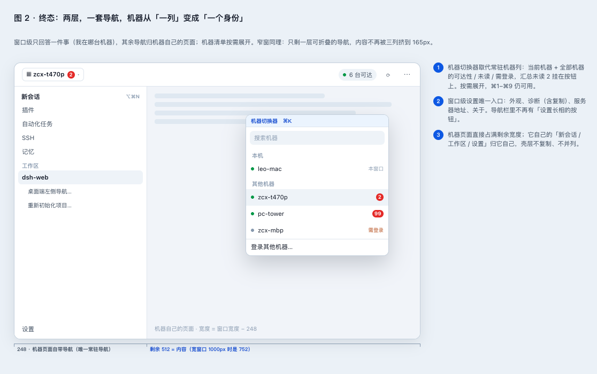
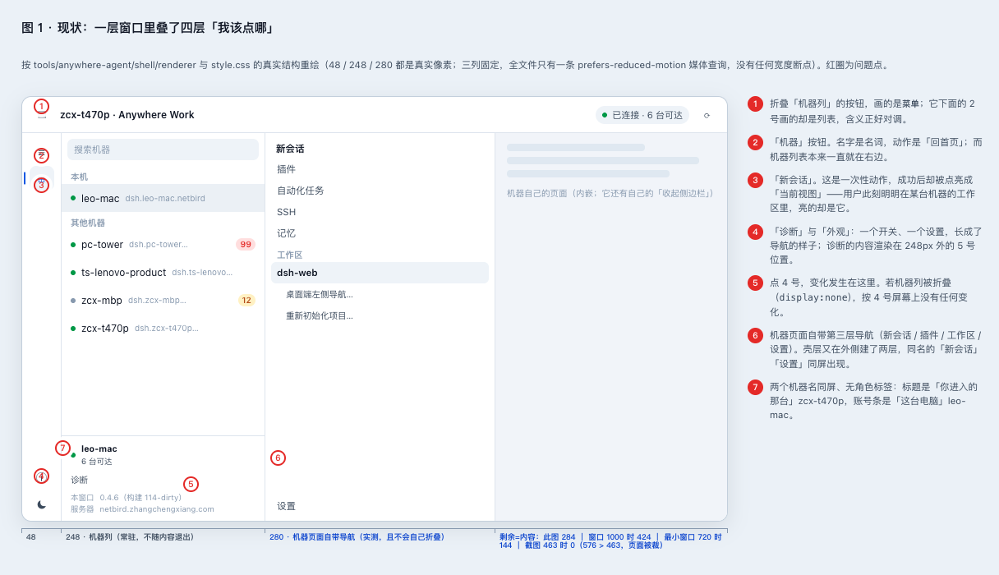

# 桌面端左侧导航：走查、评审与重构方案

2026-10-30 · 范围：`tools/anywhere-agent`（Anywhere Work 桌面客户端）的**窗口外壳**——toolbar、rail、机器列表、detail 的排版与入口。机器页面（它自己的侧栏、面板、终端）不在评审范围，只作为"内容"计入宽度。

本次只读走查，未改动任何代码。所有数字都是实测或从代码里读出来的，标注了位置。

> **后续**：目标形态最终定为「带 agent 的内网浏览器」，施工依据是 [定稿方案](desktop-intranet-browser-plan-2026-10-30.md)（中间的 [形态草案](intranet-browser-design-2026-10-30.md) 也已被它取代）。本文第 2/3 节的现状盘点与冲突编号仍然有效——它是这套方案的问题清单。

---

## 0. 结论

左侧的问题不是"图标不好看"，而是三件事叠在一起：

1. **48px 的 rail 里混了四种完全不同的控件**——视图、一次性动作、开关、菜单——而它们长得一模一样（`index.html:35-47`，`app.js:413-424`）。
2. **同一个窗口并排摆了三层导航**：rail（4 项）→ 机器列（248px）→ 机器页面自带的侧栏（280px）。没有任何一条规则说"窄的时候谁让位"。
3. **宽度没有预算**：三列固定 `48 + 248 + 1fr`，全文件只有一条 `prefers-reduced-motion` 媒体查询（`style.css:190-207`，`style.css:858`）。窗口最小宽 720px 时，固定导航吃掉 576px，内容只剩 144px。

最刺眼的一处可以直接改：**用户此刻在 zcx-t470p 的工作区里，rail 上亮着的是「新会话」。** 位置标记指向了一个动作名，等于告诉用户"你按过的按钮"，而不是"你在哪"。这是"功能冲突"最直接的证据——它不是一个按钮写错了，是**当前视图的唯一标记被一个动作占用**。

建议按三步走，每步都能单独上线、单独回滚：

| 步 | 做什么 | 工期 | 风险 |
| --- | --- | --- | --- |
| **P0** | rail 4 → 2，删掉 rail 上的「新会话」，诊断收敛到一个入口，设置有自己的家，图标去歧义 | ~0.5 天 | 低（不动结构，只动语义） |
| **P1** | 收掉"首页"这一屏：没有机器在屏时就是机器列表本身 | ~1 天 | 中（改视图模型与七态截图） |
| **P2** | 机器从"一列"变成"一个身份"：titlebar 切换器 + 三列变两列 | ~2-3 天 | 中高（结构改，但有 tag 级回滚） |

如果只做一件事：**P0 里的 C2 和 C1**（删 rail 的「新会话」、把 rail 压到 2 项）。

---

## 1. 终态：左侧只该有两层

### 1.1 这个产品自己要什么

`DESIGN.md` 第一节已经把目标函数写死了：**"工具，不是内容产品……目标函数是最短可靠路径"**，主界面只回答两件事：**我有哪些机器**、**现在能不能进**。

第十一节还写了一句对本次评审最关键的事实：*"单机用户没有别的机器，所以本机这一行是他唯一会看到的徽标"*。也就是说**主力形态是单机**。那么常驻 248px 的机器列，对最常见的那批用户是净损耗——他们整场只用一台机器，却永远付着这 248px。

### 1.2 外部证据

| 来源 | 结论 | 在本文里对应哪一条 |
| --- | --- | --- |
| [Apple HIG · Sidebars](https://developer.apple.com/design/human-interface-guidelines/sidebars) / [Mac 侧栏指南](https://marioaguzman.github.io/design/sidebarguidelines/) | 侧栏是"在侧栏里选对象 → 在详情里操作"；**一个侧栏不超过两层层级**；超过就要在主侧栏与详情之间加**第二个来源列表** | 三列本身不犯规（Notes 就是三列）。犯规的是**没人说明这三列各自属于谁、谁先让位** |
| [NN/g · 桌面端左侧垂直导航](https://www.nngroup.com/articles/vertical-nav/) | 垂直导航的主要代价就是占宽，**内容/装饰比下降** | 现状固定导航 576px；最小窗口下占 80% |
| [NN/g · Local Navigation](https://www.nngroup.com/articles/local-navigation/) | **视觉层级必须反映信息层级**；局部导航不得比全局导航更显眼 | rail、机器列、页面侧栏三者视觉权重相同；页面内「新会话」与 rail「新会话」同权重同名词 |
| [BuiltUX · 多租户工作区切换器](https://builtux.com/multi-tenant-workspace-switchers-saas-ux-patterns/) | 切换器有四种形态；**形态取决于切换频率**——单租户为主时，头部下拉优于常驻 rail/列 | 本产品单机为主 → 机器应该是一个"身份切换器"，不是一个常驻列 |
| 同代客户端（Notion / Figma / GitHub / Linear） | 工作区是 titlebar / 侧栏顶部的一个下拉，不是一列 | P2 的形态依据 |

### 1.3 目标结构



- **窗口级 = 机器身份**：titlebar 左侧一个切换器，写着当前机器名，挂汇总未读；点开是带搜索的机器清单（本机 / 其他机器 / 可达性 / 未读 / 需登录 / 登录入口）。⌘1–⌘9 仍然可用，但只在清单展开时才有编号含义。
- **窗口级设置**：titlebar 右侧一个「⋯」，收进外观、诊断（含复制）、服务器地址、关于。**这是窗口级设置的唯一入口。**
- **机器级 = 页面自己的导航**：新会话、插件、自动化任务、SSH、记忆、工作区树、机器自己的设置——全部归页面，壳层不复制、不并列。
- **没有机器在屏时**：detail 就是机器清单本身（全宽、带状态与徽标），不再有一张"空屏首页"。

### 1.4 三条可检查的原则

| 编号 | 原则 | 怎么验 |
| --- | --- | --- |
| P1 | 一个层级只有一套导航，每套导航有明确所有者 | 任一时刻，屏幕上标记"你在这里"的控件不超过 2 个：一个窗口级、一个页面级 |
| P2 | 位置标记只给视图；动作不许占据"你在这里" | 点击任一"动作"按钮后，`[aria-current=page]` 不变 |
| P3 | 反馈就地发生；设置只有一个家 | 任一按钮按下后，**可见**变化出现在该按钮 24px 邻域内；窗口级设置只有一个入口 |

---

## 2. 现状盘点

### 2.1 宽度预算：三列固定，没有断点

```css
/* style.css:190-207 */
.split { grid-template-columns: 48px 248px 1fr; }
body[data-sidebar='hidden'] .split { grid-template-columns: 48px 1fr; }
body[data-sidebar='hidden'] .sidebar { display: none; }
```

机器页面自带的侧栏实测 **280px，且不随视口收窄而折叠**（在 424 / 500 / 720 / 1000 / 1280 五个宽度下都是 280，树区 270）。

于是窗口宽度直接决定内容宽度：

| 窗口宽 | 固定导航（48 + 248 + 280） | 内容宽 | 观感 |
| --- | --- | --- | --- |
| 1280 | 576 | 704 | 正常 |
| 1000（默认打开尺寸） | 576 | 424 | 偏挤 |
| **720（`minWidth`，`main.mjs:1674-1681`）** | 576 | **144** | 不可用 |
| **463（你截图那台）** | 576 > 463 | **0，页面被裁** | 就是你看到的样子 |

也就是说：**这个窗口在自己的最小尺寸下，80% 的宽度是导航**；在截图那个宽度下，导航比窗口还宽。

### 2.2 左侧可点元素清单

同一个能力平均有 2–3 个入口，其中 5 个能力有 3 个以上：

| # | 能力 | 入口 | 数量 |
| --- | --- | --- | --- |
| 1 | 折叠机器列 | toolbar 图标 / ⌘⌥S / 视图菜单「显示或隐藏侧栏」 | 3 |
| 2 | 打开某台机器 | 列表行点击 / 首页主按钮 / ⌘1–⌘9 / 搜索框按 Enter | 4 |
| 3 | 回到机器列表（首页） | rail「机器」 | 1 |
| 4 | 新会话 | rail「新会话」（= 重新加载该机器的门厅）/ 机器页面自带「新会话」（= 在该工作区新建对话） | **2 个同名、不同作用域** |
| 5 | 刷新 | toolbar ⟳ / 视图菜单「刷新」（同一个 ⌘R） | 2 个 UI |
| 6 | 搜索机器 | 搜索框 / ⌘F / 视图菜单 | 3 |
| 7 | 诊断 | rail ⓘ / 列表底部「诊断」 / 帮助「复制诊断信息」 | 3（DESIGN.md 第十节还写了面板上的「复制诊断」动作，代码里不存在） |
| 8 | 外观 | rail 暗色 / 视图菜单「外观」 | 2 |
| 9 | 服务器地址 | 视图菜单「设置服务器地址…」 / 状态面板的服务器行「更改」 / 诊断里的只读行 | 2 可改 + 1 只读 |

### 2.3 七个冲突（对应图 1 的编号）



**C1 · rail 混装四种控件，外观完全同构**，只有 `data-active` / `aria-pressed` 一份样式差异（`app.js:413-424`）：

| rail 项 | 真实类型 | 状态体现在哪 |
| --- | --- | --- |
| 列表 机器 | **视图**（回首页） | `data-active` + 左缘 2px 条 |
| ⊞ 新会话 | **一次性动作** | 成功后把自己点亮成"当前视图" |
| ⓘ 诊断 | **开关** | `aria-pressed`，内容渲染在 248px 外的列表底部 |
| 暗色 外观 | **菜单**（原生弹窗） | 自身无状态 |

**C2 · 位置标记指向动作。** `view.js:130` 写死 `RAIL_ACTIVE = { home: 'machines', workspace: 'session' }`——只要进了工作区，亮的永远是「新会话」。你在 zcx-t470p 里干活，rail 说"你刚按了新会话"。

**C3 · 「机器」是名词，动作是"回首页"。** 而且机器列表本来就一直显示在右边。这个按钮改名成「回首页」才对得上它做的事，但那样它就只是"离开当前机器"——一个应该放在机器行/Esc 上的动作，而不是导航。

**C4 · 左上角两个按钮的图标语义对调。** toolbar 的折叠按钮画的是"带分隔线的矩形"（`index.html:13-16`），执行的是**折叠列表**；rail 第一个按钮画的是**三横线（通行的菜单/列表符号）**（`index.html:35-37`），执行的是**回首页**。两者垂直相邻 14px、尺寸相近（26×24 与 32×32）。用户按"菜单"得到布局开关，按"分栏"得到页面跳转。

**C5 · 诊断有两个入口，且其中一个会静默失败。** rail ⓘ 与列表底部「诊断」共享 `ui.diagnostics`（`app.js:545`），但内容只渲染在 `.sidebar-foot` 里；列表折叠时 `.sidebar { display: none }`（`style.css:203-207`），按下 ⓘ 后**屏幕上没有任何变化**，只有 `aria-pressed` 变了。这正是 `H1`（系统状态可见）与 `H8`（极简）打架时最坏的形态：按钮看起来还能按。

**C6 · 设置没有家。** 外观在 rail、诊断在列表底部、服务器地址在视图菜单、复制诊断在帮助菜单、缩放/全屏在视图菜单——五个设置项散在四个容器里；而窗口级设置**没有任何容器**。机器页面的「设置」属于那台机器的 DSH，不是这个窗口的。

**C7 · 两个机器名同屏，没有角色标签。** 标题"zcx-t470p · Anywhere Work"是**你进入的那台**；左下账号条"leo-mac · 6 台可达"是**这台电脑**。两处都只写名字，没有"当前工作区 / 本机"这样的角色词。同一屏还出现两次「新会话」、两处「设置」——同名不同层。

另外两条不算"冲突"但同源：

- **C8 · 内外两层都能折叠，却没有规则。** 外壳折机器列（toolbar 按钮 / `⌘⌥S`），机器页面自己也折侧栏（页面自带「收起侧边栏」）。窄窗口下要先折外层、再折内层才够宽，而外壳从不提示这件事——它连断点都没有。
- **C9 · 首页是一张空屏。** 它只有一句问句 + 一个写着机器名的主按钮（`view.js:419` 的 `open-selected`），而同一屏的列表里那台机器已经选中、点行就是打开。选机器和开机器被拆成两步，用户多读一遍机器名。

### 2.4 这些行为被门禁锁着

改之前要清楚代价，不然会以为"随手改改"：

| 门禁 | 断言 |
| --- | --- |
| `test/view.test.mjs:169-201` | `rail.active` 跟着视图走；`rail.session.disabled`；`rail.diagnostics.pressed` |
| `poc/shell-states.mjs:318-321` | "rail marks the current view"、"rail follows into the workspace" |
| `poc/shell-states.mjs:391-396` | **"the rail has four entries"**、**"the rail stays when the list folds"** |
| `DESIGN.md` 第六节 / 第七节 / 第十四节 | 三列 + rail 的定义；首页的三条理由；验收第 2 条 |

所以 P0 的第一步不是改 CSS，是**先改规格**（见第 5 节）。

---

## 3. Gap

| # | 现状 | 终态 | 差距 | 方案 | 优先级 |
| --- | --- | --- | --- | --- | --- |
| C1 | rail 混装视图/动作/开关/菜单 | rail 只承载导航（最多一个"设置"入口） | 四种控件同构 | rail 4→2：`机器`（视图）+ `⋯`（窗口级设置面板） | **P0** |
| C2 | 在机器里时亮着「新会话」 | 位置标记只给视图 | 动作被提升为位置 | 删除 rail「新会话」；"重新加载该机器门厅"改为机器行动作 + 视图菜单命令 | **P0** |
| C3 | 「机器」= 回首页，列表常驻 | 机器是身份，不是一列 | 名词配了跳转动作 | P0 先改名（"机器列表/返回"并换图标）；P2 由切换器取代 | P0 / P2 |
| C4 | 折叠按钮画菜单、回首页画列表 | 图标即语义，且层级不同 | 两个图标对调 | 折叠保持 sidebar 字形；回首页换成"机器/网格"字形；尺寸分两级（26×24 vs 32×32） | **P0** |
| C5 | 诊断双入口，折叠时静默失败 | 一个入口，就地生效 | 同一状态两控件异地 | 删 rail ⓘ；只留列表底部 disclosure（它就在事实旁边）；帮助菜单保留"复制诊断" | **P0** |
| C6 | 设置散落 4 处 | 窗口级设置一个家 | 无容器 | 新增轻量设置面板：外观 / 服务器 / 诊断（含复制）/ 关于（版本+构建）；视图菜单保留快捷键但不作为唯一入口 | P0 |
| C7 | 两机器名同屏无角色 | 角色词明确 | 缺标签 | 标题改为 `<机器> · 工作区`；账号条加"本机"前缀 | P0 |
| C8 | 三列固定、无断点、折叠方向反 | 宽度预算三档，先折外层 | 无人管宽度 | 断点：≥1100 三列 / 780–1100 机器列默认折叠 / <780 机器列变 overlay；任何宽度下内容 ≥ 60% | P1 / P2 |
| C9 | 首页是空屏 | 列表兼首页 | 多一屏 | 删首页视图；无机器在屏时列表全宽 | P1 |
| — | 单机用户付 248px | 机器按需展开 | 常驻成本 | titlebar 切换器 + 机器列默认收起（⌘K 打开） | P2 |

---

## 4. 迭代方案

### P0 · 语义修复（不动结构，1 个 PR）

改什么：

1. `renderer/index.html:13-47`：rail 只留 2 项——「机器列表」（沿用 `rail-machines` 的 id，换图标与 `aria-label`）与新「设置」（`rail-settings`，打开设置面板）。删 `rail-session`、`rail-diagnostics`、`rail-appearance`。
2. `renderer/app.js`：`applyRail()` 简化成"一个视图 + 一个菜单"；新增 `openSettings()`；把 `newSession()` 挂到机器行右键菜单与视图菜单「重新加载此机器首页」；不要用 `⌥⌘N`，页面里那个组合已经是「新建对话」。
3. `renderer/view.js`：`RAIL_ACTIVE` 只剩 `home`；`rail.session` 从模型里删除。
4. 新增 `settings-panel`（复用一个 320px 的 popover，不需要新页面）：外观（三个 radio）/ 服务器地址（就地编辑）/ 诊断（只读行 + 「复制」）/ 关于（版本 + 构建）。
5. 标题加角色词；账号条加"本机"。

验收（可机器检查）：

- `node --test tools/anywhere-agent/test/*.test.mjs` 全绿，`view.test.mjs` 的 rail 断言改成"2 项 + 设置项 always available"。
- `poc/shell-states.mjs`：把"rail has four entries"改成 **"rail has two entries"**，并新增三条断言：
  - 点 rail 上任意按钮后，`aria-current=page` 的控件数量 ≤ 1；
  - 折叠列表后，诊断内容仍可通过 ≥1 个入口看到（现在为 0）；
  - 任一 rail 按钮按下后，600ms 内其 24px 邻域内出现可见变化（防"静默失败"回归）。
- 七态 × 深浅两色截图重拍。

回滚：单 PR revert，无数据/协议变化。

要你拍板的点：**rail 是否保留"设置"这一项**。保留=窗口级设置有了常驻入口但 rail 仍是 2 项；不保留=设置只在 titlebar，rail 只剩 1 项（那其实可以不要 rail）。

### P1 · 收掉"首页"这一屏（结构小改）

1. 没有机器在屏时：`detail` 直接显示机器列表（全宽、可搜索、带徽标），不再有 `home` 面板。
2. 「机器列表」按钮的语义变成"离开当前机器"（Esc、`⌘⌥←` 同义）。
3. 机器行点击 = 打开；首页主按钮删除。

验收：`poc/shell-states.mjs` 七态里 `home` 全部换成"全宽列表"；新增断言"没有机器在屏时，屏幕上的机器清单元素 ≥ 1 且宽度 ≥ 窗口 70%"。

回滚：`view.js` 里 `homePanel()` 保留，开关一个常量即可切回。

### P2 · 机器从"一列"变成"一个身份"（结构大改）

1. toolbar 加机器切换器（当前机器名 + 汇总未读 + 可达性），点开是带搜索的 popover；⌘K 打开；⌘1–9 在 popover 内生效。
2. 机器列默认收起，只在 popover / 首启时出现；三列 → 两列。
3. 断点：`< 900` 时把窗口宽度信息传给机器页面（它自己的侧栏折叠由页面能力决定，壳层只负责给足宽度）。
4. 删掉 rail。

验收：新增 POC 场景（单机 / 多机 / 需登录 / 离线 / 720 窄窗 / 1280 宽窗），断言**任意宽度下内容 ≥ 窗口 60%**、切换机器后页面路由不丢（BuiltUX 的"上下文保持"）。

回滚：tag 级（客户端可回退安装包）+ 保留旧布局的 `data-layout="three-column"` 分支一个版本。

---

## 5. 需要同步改写的规格与门禁

| 位置 | 现在写的 | 改成 |
| --- | --- | --- |
| `DESIGN.md` 第六节 | 三列 + rail 四项；"rail 是应用自己的导航" | 两层；rail 只承载导航或不存在；补一节"宽度预算三档" |
| `DESIGN.md` 第七节 | 首页是发射台（三条理由） | 删；改为"列表兼首页"，理由是它省掉一层空屏 |
| `DESIGN.md` 第十节 | 面板动作含"复制诊断" | 与代码对齐（现在只有帮助菜单有） |
| `DESIGN.md` 第十四节 | 验收断言"rail 存在且有四项""折叠列表后 rail 仍在" | 改成 P0 的三条新断言 + P2 的宽度断言 |
| `test/view.test.mjs:169-201` | rail 双视图模型 | 单视图 + 设置项 |
| `poc/shell-states.mjs:318-396` | 四项 rail | 两项；新增"无静默失败"断言 |

---

## 附 A · 两个备选变体

| 变体 | 做法 | 优点 | 代价 | 建议 |
| --- | --- | --- | --- | --- |
| **保守** | 只做 P0 + 加一条断点：窗口 < 900px 时机器列自动折叠，`⌘F` / toolbar 以 overlay 展开 | 一天到一天半；不动视图模型；立刻解决图标/静默失败/设置散落与窄窗裁切 | 宽窗口下仍是三列；"首页空屏"还在 | 想最快止血就选它 |
| **激进** | 把机器列表与机器页面导航合并成一个侧栏 | 列数最少 | **要复刻官方侧栏**（工作区树、面板、设置），双维护、必漂移 | **不建议**：违反"内嵌机器自己的页面"这条已有决策 |

## 附 B · 本次走查的方法与边界

- 读了 `tools/anywhere-agent/shell/renderer/{index.html,app.js,view.js,style.css,tokens.json}`、`shell/main.mjs`（窗口与菜单）、`DESIGN.md`、`test/view.test.mjs`、`poc/shell-states.mjs`。
- 宽度数字来自两类实测：代码里的 `grid-template-columns` 与 `minWidth`；在运行中的 DSH Web GUI 上按 424/500/720/1000/1280 五个视口量机器页面侧栏（恒为 280px）。
- 没有在本机启动 Electron 客户端，也没有改动任何文件；两张图是按真实结构与真实像素重绘的示意图，不是截图。

### 这次不该动的东西

评审不等于推翻。下面这些决定是对的，P0–P2 都不应该碰：

- **状态放在始终可见的位置**（toolbar 的 pill），而不是折叠区里。
- **未读徽标带数字**，且只有失败才用红色（`unreadTone`）。
- **不登录也能用**：本机这一半在任何私网状态下都可操作。
- **rail "当前视图"的视觉工艺**（填充 + 品牌色字形 + 贴左缘 2px 条）——这个做法本身没有问题，问题只是它现在标在了一个动作上。
- **一个窗口、工作区内嵌**，不做第二窗口。
